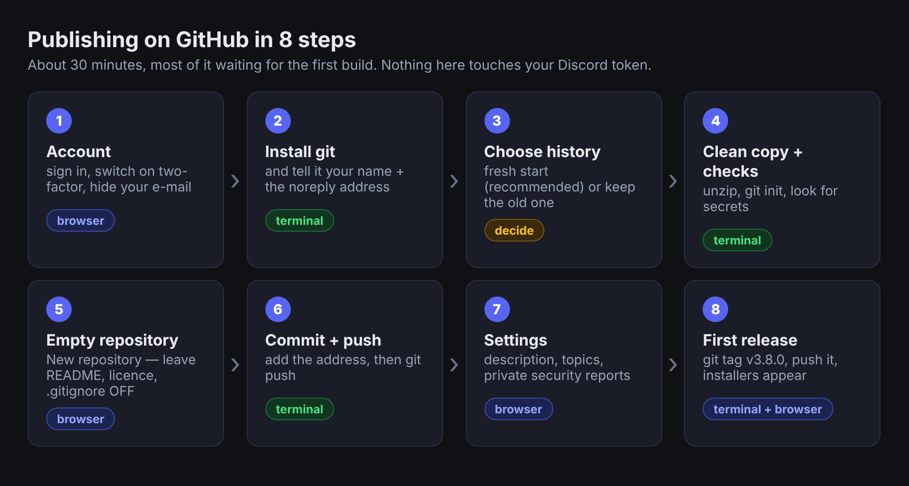
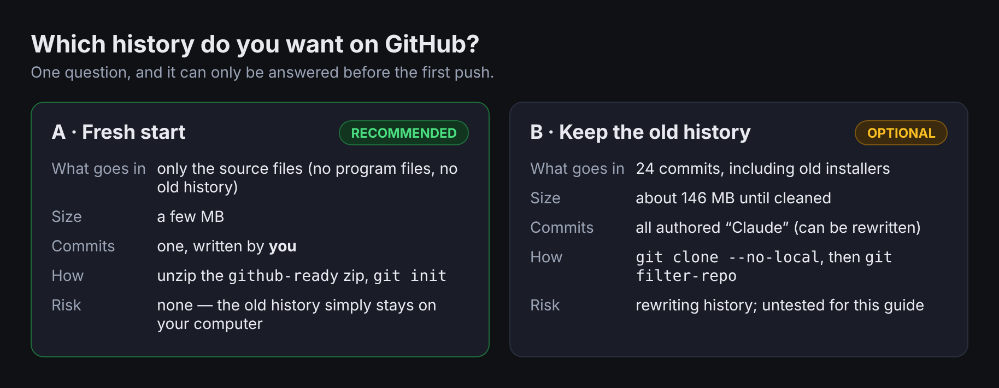
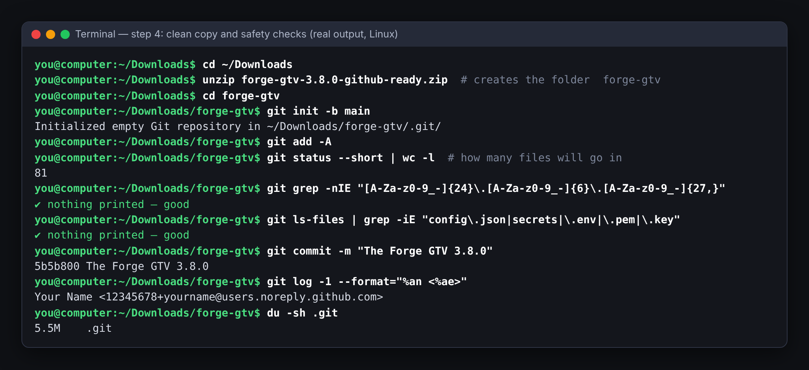
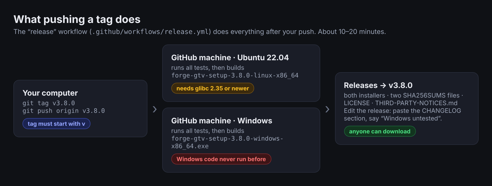

# The Forge GTV — publishing it on GitHub (walkthrough)

**Owner: [TFG]Aciddrop** · Rust edition 3.8.0 · works the same on Linux and Windows (the commands are given for both)

> Free software under the GNU GPL v3 or later, no warranty — see the end of this guide.
>
> **About the pictures.** The terminal picture is the real output of the commands in step 4 run on a copy of the 3.8.0 source
> (the name and address in it are throw-away examples). Diagrams are drawings. **There are no pictures of GitHub's own web
> pages in this guide**: the screens belong to GitHub and change, so the guide names the buttons in **bold** instead. A few of
> those names were checked against GitHub's documentation (links at the end); the rest are described from how GitHub works.



## What you are going to do

You will put the project's **source code** on GitHub (one repository), check that GitHub can build and test it by itself, and
publish the **installers** on the repository's *Releases* page. About 30 minutes, most of it waiting for the first build.

| # | Step | Where | Time |
|---|---|---|---|
| 1 | Account, two-factor, and a private e-mail address | browser | 5 min |
| 2 | Install `git` and tell it who you are | terminal | 3 min |
| 3 | Choose the history (fresh start — recommended) | – | 1 min |
| 4 | Make a clean copy and check it holds no secrets | terminal | 5 min |
| 5 | Create the empty repository on GitHub | browser | 2 min |
| 6 | Commit and push | terminal | 3 min |
| 7 | Settings: description, private security reports | browser | 3 min |
| 8 | First release (installers for Linux **and** Windows) | terminal + browser | 15 min wait |

**What you need:** a computer with internet, the file `forge-gtv-3.8.0-github-ready.zip` that came with this guide, and a
GitHub account. Nothing here needs the bot to be running, and **your Discord token never goes near any of this** — it lives in
your own `config.json`, which the project's `.gitignore` keeps out of `git`.

---

## 1. Account, two-factor, private e-mail

1. Sign up (or sign in) at <https://github.com>. Your **username** becomes part of the address:
   `https://github.com/<username>/forge-gtv`. (A username cannot contain `[` `]`, so `[TFG]Aciddrop` itself is not possible; the
   project text keeps crediting the owner, which is required by the licence and is not something you change on GitHub.)
2. Switch on **two-factor authentication**: your avatar → **Settings** → **Password and authentication** →
   **Enable two-factor authentication**. A project that people download programs from is worth protecting.
3. Hide your real e-mail address. Every commit carries an e-mail address and a public repository shows it to the world. Go to
   **Settings** → **Emails**, tick **Keep my email addresses private** (and **Block command line pushes that expose my
   email** if you like), then copy the address shown there that ends in **`@users.noreply.github.com`** — you will paste it in
   step 2. It looks like `12345678+yourname@users.noreply.github.com`.

## 2. Install git and tell it who you are

**Linux** — `sudo apt install git` (Debian/Ubuntu), `sudo dnf install git` (Fedora), `sudo pacman -S git` (Arch).
**Windows** *(not tried on Windows by the author)* — install **Git for Windows** from <https://git-scm.com/download/win> with
the default options (it includes *Git Credential Manager*, which handles the sign-in for you), then open **PowerShell**.

Then, once per computer (use **your** name and the noreply address from step 1):

```
git config --global user.name  "Your Name"
git config --global user.email "12345678+yourname@users.noreply.github.com"
git config --global init.defaultBranch main
git --version
```

## 3. Choose the history



The project folder the bot was built in has a working history of 24 commits. **Do not publish that one** unless you really want
it, for two reasons that are both real: early commits contain program files (installers of about 20 MB each — the history is
about 146 MB for fewer than 100 source files), and every commit is authored "Claude", not you.

**Recommended: a fresh start.** The `github-ready` zip holds exactly the files that belong in the repository and nothing else
(no `target/`, no installers, no history). You make one first commit under your own name. The rest of this guide does that.

*Only if you want the old history:* keep your own copy of the project folder and read "Keeping the old history" near the end.

## 4. Make a clean copy and check it

Put `forge-gtv-3.8.0-github-ready.zip` in your **Downloads** folder, then:

**Linux**

```
cd ~/Downloads
unzip forge-gtv-3.8.0-github-ready.zip        # creates the folder  forge-gtv
cd forge-gtv
git init -b main
git add -A
git status --short | wc -l                     # how many files will go in (81 for 3.8.0)
```

**Windows (PowerShell)**

```
cd $env:USERPROFILE\Downloads
Expand-Archive .\forge-gtv-3.8.0-github-ready.zip -DestinationPath .
cd forge-gtv
git init -b main
git add -A
(git status --short | Measure-Object).Count   # how many files will go in
```

Now the safety checks. **Both must print nothing** (the second prints only a list of names if something matches):

```
git grep -nIE "[A-Za-z0-9_-]{24}\.[A-Za-z0-9_-]{6}\.[A-Za-z0-9_-]{27,}"
git ls-files | grep -iE "config\.json|secrets|\.env|\.pem|\.key"
```

On Windows replace `grep -iE` with `Select-String -Pattern` in the second line. The first looks for anything shaped like a Discord
bot token; the second for files that should never be published. Then search for **your own** private details — your server's IP
address and your RCON password — for example `git grep -n "203.0.113.10"` (use yours). The program and its guides use only
example addresses, but a file you added yourself might not.



> **Found a real token or password?** Stop. Do not commit. Remove it from the file, and if it was ever in a place other people
> could see, change it: *Reset Token* in the Discord Developer Portal, a new RCON password on the game server.

Last step here: look at what git will record, then commit.

```
git commit -m "The Forge GTV 3.8.0"
git log --oneline
git log -1 --format="%an <%ae>"                # must show YOUR name and the noreply address
```

If the last line shows another name or your real e-mail, fix it before pushing:
`git commit --amend --reset-author --no-edit`.

## 5. Create the empty repository on GitHub

In the browser: the **+** at the top right → **New repository**.

| Field | What to enter |
|---|---|
| **Repository name** | `forge-gtv` (any name works; the rest of this guide uses this one) |
| **Description** | *Broadcast an Urban Terror server into Discord: scoreboard, kill feed, optional spectator video.* |
| **Public / Private** | **Public** lets anyone download and costs you nothing to build. **Private** works too, but see the note under step 8. |
| **Add a README file** | **leave OFF** |
| **Add .gitignore** | **None** (the project already has one) |
| **Choose a license** | **None** (the project already has `LICENSE`) |

Press **Create repository**. GitHub shows an empty page with a few commands. **Do not use "Add a README"** — a repository that
already has a file refuses your first push (see Troubleshooting).

## 6. Commit and push

Copy the repository address from that page (the HTTPS one, `https://github.com/<username>/forge-gtv.git`), then in the project
folder:

```
git remote add origin https://github.com/<username>/forge-gtv.git
git push -u origin main
```

**Signing in.** On **Windows**, a window opens: choose **Sign in with your browser** and approve. On **Linux**, pick one:

* **GitHub CLI (easiest):** install `gh` from <https://cli.github.com>, run `gh auth login`, choose *GitHub.com → HTTPS →
  Login with a web browser*, then push again. (With `gh` you can also create and push in one go:
  `gh repo create forge-gtv --public --source . --remote origin --push`, which replaces step 5 and this step.)
* **A personal access token:** on GitHub **Settings** → **Developer settings** → **Personal access tokens** →
  **Fine-grained tokens** → **Generate new token**. Limit it to **Only select repositories → forge-gtv**; under *Repository
  permissions* set **Contents: Read and write** and **Workflows: Read and write**. When `git push` asks for a password, paste
  the token (not your GitHub password — GitHub no longer accepts that). The *Workflows* permission matters because the project
  contains `.github/workflows/` files; without it the push is refused (see Troubleshooting).

Reload the repository page: the files, the `README.md` text and the pictures should appear, and the right-hand side should say
**GPL-3.0 license** (GitHub reads it from `LICENSE`).

## 7. Settings worth five minutes

All in the repository's **Settings** tab (and the front page).

1. **About** (the cogwheel on the front page): add the description and **Topics** such as `urban-terror`, `discord-bot`, `rust`,
   `quake3`, `gtv`, `spectator`.
2. **Private vulnerability reporting.** `SECURITY.md` tells people to use it, so switch it on: **Settings** → **Advanced
   Security** → next to *Private vulnerability reporting* press **Enable**. Without it, people have no private way to tell you.
3. **The security link in the issue form.** Open `.github/ISSUE_TEMPLATE/config.yml` and change the `url:` line to
   `https://github.com/<username>/forge-gtv/security/advisories/new`, then commit and push (below).
4. **Actions** tab: the **ci** workflow should already be running on your push. Open it. The **linux** job builds and runs all
   the tests; it should turn green in about 5–10 minutes. The **windows** job is marked *informational* on purpose: the Windows
   code has never been run on Windows, so a red Windows job is a lead to follow, not a failure of your upload.
5. Optional: **Settings** → **Branches** → add a rule for `main` that requires the **linux** check to pass before merging.

Changing a file later is always the same three commands:

```
git add -A
git commit -m "What you changed"
git push
```

## 8. The first release (installers on the Releases page)

The project ships a workflow, `.github/workflows/release.yml`, that builds the installer on a **Linux** machine **and a Windows
machine** at GitHub, runs the tests on both, and attaches the files to a Release. You start it by pushing a **tag** that begins
with `v`:



```
git tag v3.8.0
git push origin v3.8.0
```

Watch the **Actions** tab (workflow **release**; both jobs take roughly 10–20 minutes the first time). When both finish, the
front page shows **Releases → v3.8.0** with these files: `forge-gtv-setup-3.8.0-linux-x86_64`,
`forge-gtv-setup-3.8.0-windows-x86_64.exe`, the two `SHA256SUMS-…txt` files, `LICENSE` and `THIRD-PARTY-NOTICES.md`.

**Or without the command line:** open the **Actions** tab → **release** (left list) → **Run workflow**, type the tag (for example
`v3.8.0`) in the box and press the green button. The same two builds run, and one final job creates the Release. Leave the box
**empty** to only build: the two installers then appear as downloads at the bottom of the finished run and nothing is published.
This is also how someone who **forks** your repository makes their own release from the source: they fork, open their fork's
**Actions** tab, press the green *I understand my workflows, go ahead and enable them* button, and run **release** the same way.
Their release appears on their fork's front page. See `BUILDING.md` for compiling on your own computer.

Then press the pencil on the release and paste the `3.8.0` section of `CHANGELOG.md` as its description. **Say in it that the
Windows installer is untested**, as the README does.

Things to know before you do this:

* **The Windows file is built on GitHub's Windows machine, and nobody has run it yet.** If that job fails to compile, open it, copy the
  red part of the log and send it to whoever maintains the project (or to Claude). A Windows *test* that fails is shown as a warning
  but does not stop the `.exe` from being published.
* **Which Linux?** The release job builds on GitHub's Ubuntu 22.04, so its Linux installer needs a distribution about that new
  (glibc 2.35 or later: Ubuntu 22.04+, Debian 12+, Fedora 36+). The file in the zip you installed from was built with
  `tools/release.sh` and runs on much older systems (glibc 2.17). If you want that wider file on the Releases page, press
  **Edit** on the release and upload it by hand, or leave the CI file out of the instructions you give people.
* **Private repository?** GitHub gives private repositories a monthly allowance of Actions minutes, and Windows minutes count
  double. A few release builds fit in the free allowance; check your plan under **Settings → Billing**. Public repositories are
  not limited this way.
* A tag cannot be reused. To redo a release: delete the release and the tag on GitHub (`git push origin :refs/tags/v3.8.0`),
  fix, and tag again.
* Every new version after this: change `version` in `Cargo.toml`, add the entry to `CHANGELOG.md`, commit, push, then
  `git tag vX.Y.Z` and `git push origin vX.Y.Z`.

---

## Updating a repository that is already on GitHub (a new version)

Every new version comes as a new `forge-gtv-X.Y.Z-github-ready.zip`. Two ways to put it on GitHub; pick one.

**A. Start the history again (simplest, and every file then shows the new commit message).** This replaces everything on GitHub:

```
cd ~/Downloads
unzip forge-gtv-X.Y.Z-github-ready.zip -d gtv-new          # Windows PowerShell: Expand-Archive .\forge-gtv-X.Y.Z-github-ready.zip -DestinationPath gtv-new
cd gtv-new/forge-gtv
git init -b main
git add -A
git commit -m "The Forge GTV X.Y.Z"
git remote add origin https://github.com/YOU/forge-gtv.git
git push --force origin main
```

**B. Keep the old history.** Clone your repository, copy **every file and folder** of the new version over it (including the hidden `.github` folder and
all sub-folders; do not touch the `.git` folder inside the clone), then `git add -A`, `git commit -m "The Forge GTV X.Y.Z"`, `git push origin main`.
After this, GitHub's file list shows the new message only on the files that actually changed.

Then check that it worked: open `Cargo.toml` on GitHub and look at the `version` line, and look at the latest commit. The release is built from
that commit, and its file names come from that `version` line. When the *ci* run on `main` is green for Linux, make the release: Actions → *release* →
*Run workflow* → type `vX.Y.Z`. A wrong release or tag can be removed first (Releases → Delete, then
`git push origin --delete vX.Y.Z`). The angle-bracket words in other git instructions are placeholders: type the real value, not the brackets.

## Keeping the old history (optional)

Only do this if you want those 24 commits. `git filter-repo` rewrites history and insists on a **fresh clone**, so make one
from the project folder (the one that contains `.git`) and leave the original untouched:

```
git clone --no-local /path/to/the/project forge-gtv-history
cd forge-gtv-history
pip install git-filter-repo
git filter-repo --path dist --invert-paths        # drop the old installers
git filter-repo --mailmap ../mailmap.txt          # optional: rewrite the author, see below
du -sh .git                                        # should now be a few MB
```

`mailmap.txt` holds one line: `Your Name <12345678+yourname@users.noreply.github.com> Claude <noreply@anthropic.com>`. Then
continue at step 5. If you skip the first command, GitHub will still accept the push (each file is under its 100 MB limit)
but the repository will be about 150 MB and carry old installers forever. *The `filter-repo` commands were not run for this
guide.*

## Troubleshooting

| You see | Cause | Fix |
|---|---|---|
| `fatal: not a git repository` | you are not inside the `forge-gtv` folder | `cd` into it; `ls -a` (or `dir -Force`) shows `.git` |
| `Author identity unknown` / `Please tell me who you are` | step 2 not done | run the three `git config --global` lines |
| `error: src refspec main does not match any` | nothing committed yet, or the branch is called `master` | `git commit …` first; `git branch -M main` |
| `remote origin already exists` | you ran `git remote add` twice | `git remote set-url origin https://github.com/<username>/forge-gtv.git` |
| `Support for password authentication was removed` / `Authentication failed` | typed your GitHub password | use the browser sign-in, `gh auth login`, or a token (step 6) |
| `refusing to allow a Personal Access Token / an OAuth App to create or update workflow … without workflow scope` | the token cannot touch `.github/workflows/` | give a fine-grained token **Workflows: Read and write**, or a classic token the **workflow** scope; with `gh`: `gh auth refresh -s workflow`; on Windows delete the stored GitHub entry in *Credential Manager* and push again |
| `failed to push some refs … fetch first` / `unrelated histories` | the GitHub repository was created **with** a README or licence | easiest: delete the empty repository on GitHub (**Settings → Danger Zone**), create it again with those boxes off, push again |
| `warning: LF will be replaced by CRLF` (Windows) | normal; `.gitattributes` decides line endings | ignore it |
| The release job fails with **403** at *Attach to the release* | the token was read-only | the workflow already asks for write access; if you changed it, keep `permissions: contents: write`; on an organisation check **Settings → Actions → General → Workflow permissions** |
| Actions tab shows nothing / "workflows disabled" | a fork, or Actions switched off | **Settings → Actions → General → Allow all actions** |
| `file … exceeds GitHub's file size limit of 100 MB` | the old history with large program files was pushed | start fresh (step 3) or run the `filter-repo` command above |
| The **windows** CI job is red | expected until the Windows code has been tried | open it, read the first error, send it on; it does not block anything |

## What was and was not tested

| Part | Status |
|---|---|
| Making the clean copy from the zip, `git init`, `git add`, both safety checks, the commit and the author check | **run** on Linux with the real 3.8.0 files (the picture above is that output) |
| Pushing the branch and a `v…` tag to a repository | **run** against a local stand-in repository only; **not** against github.com |
| The two workflow files | parsed as valid YAML; the permission fix is based on GitHub's documented default (new personal repositories start with a read-only token); **never run on GitHub** |
| Every GitHub web page, button name and setting | **not run** — no GitHub account was available; two of the settings paths were read from GitHub's documentation, the rest are from knowledge of the site and may have moved |
| The PowerShell commands, Git for Windows, Credential Manager | **not run** on Windows |
| `filter-repo` | **not run** |

Sources: [Default `GITHUB_TOKEN` permissions are read-only for new repositories](https://github.blog/changelog/2023-02-02-github-actions-updating-the-default-github_token-permissions-to-read-only/) ·
[Enabling private vulnerability reporting](https://docs.github.com/en/code-security/security-advisories/working-with-repository-security-advisories/configuring-private-vulnerability-reporting-for-a-repository) ·
[The "workflow scope" push error](https://dev.to/jessehouwing/can-t-push-to-github-refusing-to-allow-an-oauth-app-to-create-or-update-workflow-without-workflow-scope-1imc)

## License and disclaimer

The Forge GTV is **free software** released under the **GNU General Public License, version 3 or later** (`LICENSE`; run
`forge-gtv license` to read the notice). It comes with **NO WARRANTY** — you use it at your own risk. Publishing it on GitHub
does not change that: keep `LICENSE`, `THIRD-PARTY-NOTICES.md` and the credit to **[TFG]Aciddrop** in the files, as the licence
and the project's own terms require. It is an independent community project, **not affiliated with or endorsed by** Frozen Sand /
the Urban Terror developers, Discord Inc. or GitHub; those names are trademarks of their owners. Urban Terror itself is **not**
included.
