# The Forge GTV — Linux install walkthrough

**Owner: [TFG]Aciddrop** · Rust edition 3.8.0 · Linux x86-64 (Ubuntu, Debian, Fedora, Arch … anything from the last ~10 years)

> Looking for Windows? See `INSTALL-WINDOWS.md`. · Free software under the GNU GPL v3 or later, no warranty — see the end of this guide.
>
> **About the pictures.** The terminal pictures marked "real" and all admin-panel pictures are screenshots of this exact
> version running (the sample password and the address `203.0.113.10` are throw-away examples). Diagrams are drawings.
> Red numbered circles are added by us to point at things.

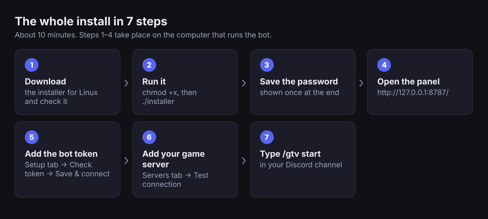

## The 10-minute path

If you just want it working and you do **not** need it to start at boot: do steps 1–7 below and skip everything marked
*(more)*. Every step has a picture of what you should see.

| Step | Do this | Needs sudo? |
|---|---|---|
| 1 | Pick how to install (Part 1) | – |
| 2 | Download, check, run the installer (Parts 2–3) | only for the "always on" choice |
| 3 | Open the panel and sign in (Part 4) | no |
| 4 | Connect Discord (Part 5) | no |
| 5 | Add your game server and kill feed (Part 6) | no |
| 6 | Prepare `server.cfg` (Part 7) | – |
| 7 | In Discord type `/gtv start` | – |

Video, firewall, upgrading and troubleshooting come after (Parts 8–12).

---

## 1. Choose how to install (the only real decision)

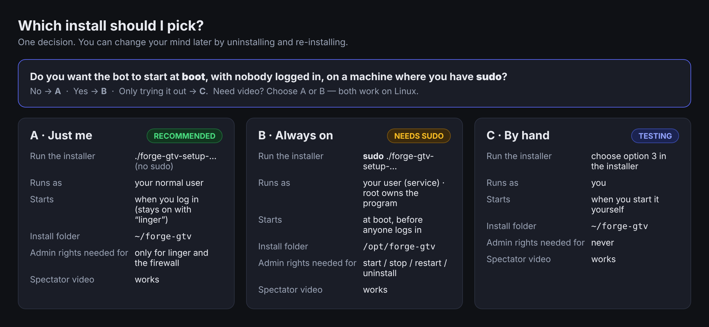

* **A — "Just me" (recommended):** run the installer as your normal user. No `sudo`. The bot is a *user service*.
* **B — "Always on":** run the installer with `sudo` **from your normal account**. The bot is a *system service* that
  starts at boot, but still runs as **you**, not root.
* **C — "By hand":** the installer registers nothing; you start the bot yourself. Good for a first try.

**Never** run the installer from a root login (`su -`, a root SSH session): the service would run as root.
Use plain `sudo ./installer` from your own account if you want B.

**Requirements:** 64-bit Linux; for A and B also `systemd` (the installer says so if it is missing and falls back to C);
the address of your Urban Terror server (IP and UDP port, usually 27960); a Discord account that can add a bot to your
server. For video only: `ffmpeg`, `xvfb`, `xdotool` and the Urban Terror client (Part 8). No Python, Rust or database needed.

## 2. Download and check the installer

Put the files in your **Downloads** folder — **not** the folder you will install to (the installer refuses that).

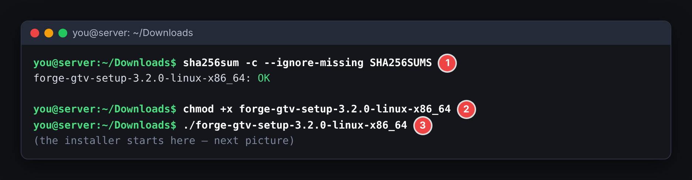

1. **①** Verify: `sha256sum -c --ignore-missing SHA256SUMS` must print `OK`.
2. **②** Make it runnable: `chmod +x forge-gtv-setup-3.8.0-linux-x86_64`.
3. **③** Run it (next part). If it says `Permission denied`, the folder may be mounted `noexec`: copy it to your home folder.

## 3. Run the installer

### Option A — normal user (no sudo)

```bash
cd ~/Downloads
./forge-gtv-setup-3.8.0-linux-x86_64
```

This is the real installer output (it was run here with the "don't register anything" answer, so the last lines differ
slightly; for A just press **Enter** at question ②):

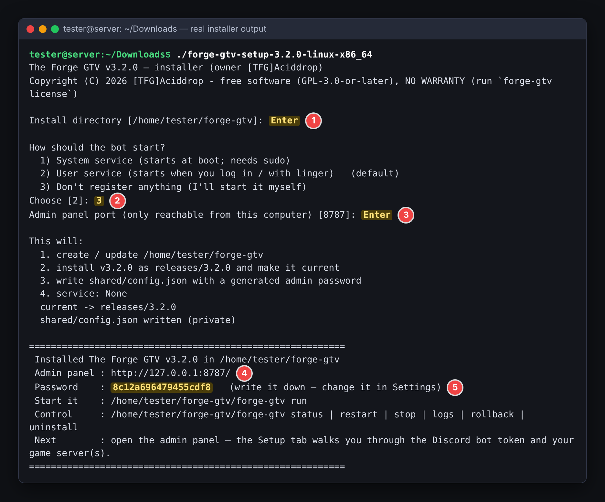

1. **Install directory** — Enter for `~/forge-gtv`.
2. **How should the bot start?** — Enter for **2) User service**.
3. **Admin panel port** — Enter for `8787`.
4. **The panel address** (`http://127.0.0.1:8787/`).
5. **The password — write it down; it is shown once.** You can change it later in the panel (Settings).

5. **Install the video tools?** — *(new in 3.3.1)* if `Xvfb`, `xdotool` or `ffmpeg` are missing, the installer explains what
   they are for and asks. Answer **Yes** (Enter) if you want spectator video: it installs **Xvfb** (the virtual screen that lets
   the game client run on a server with no monitor - "headless"), **xdotool**, **ffmpeg** and the libraries the game client
   needs (software OpenGL, SDL 1.2, OpenAL) with your package manager (`apt-get`, `dnf`, `yum`, `pacman` or `zypper`);
   `sudo` asks for your password. Answer **No** if you only want the scoreboard and kill feed; you can do it later with
   `forge-gtv install-video-deps`. It never stops the install if something fails.

With option 2 you will also see `service registered and started` and a hint about *linger* (next box).

> **Harmless browser warnings in the terminal.** When the installer opens the panel it starts your web browser, and the
> browser may print its own complaints into the same window - for example, with Firefox installed as a *snap* on Ubuntu:
> `Failed to mkdir …/snap/firefox/…/.config/ibus/bus: Not a directory`, `IBUS-WARNING`, or `failed to commit changes to dconf …
> An AppArmor policy prevents this sender from sending this message`. They come from Firefox's sandbox, **not from The Forge
> GTV**, they change nothing about the install, and you can ignore them. Just open `http://127.0.0.1:8787/` and sign in.
> Version 3.3.1 and later hide the browser's output; with an older installer you can also add `--no-open`.


> **Keep it running after you log out (linger).** A user service stops when your last login ends unless you run once:
> `sudo loginctl enable-linger "$USER"`. This is the only Option-A step that needs `sudo`, and it is optional.
>
> **"Failed to connect to bus"** from `systemctl --user` means you reached your account with `su` / `sudo -i`.
> Log in normally (fresh SSH session or console) and try again.

### Option B — system service with sudo *(more)*

```bash
cd ~/Downloads
sudo ./forge-gtv-setup-3.8.0-linux-x86_64
```

Answer: Enter for `/opt/forge-gtv`, Enter for **1) System service**, Enter for port `8787`. What it does:

| What | Where | Owner |
|---|---|---|
| Program files | `/opt/forge-gtv/releases/<version>/` | **root**, read-only for others (nobody can tamper with the program) |
| Settings, data, logs | `/opt/forge-gtv/shared/` | handed to **your account**, because the bot runs as you and must write here |
| Service | `/etc/systemd/system/forge-gtv.service` (`User=you`) | root; enabled and started, restarts on failure, starts at boot |
| Launcher | `/opt/forge-gtv/forge-gtv` | – |

Check: `ps aux | grep forge-gtv` shows the bot running as **your** user, not root.

### Option C — no service *(more)*

Choose **3) Don't register anything** (also what you get when there is no systemd).

```bash
~/forge-gtv/forge-gtv run                           # foreground; Ctrl+C stops it
nohup ~/forge-gtv/forge-gtv run >/dev/null 2>&1 &   # or run it inside tmux / screen
```

### Unattended install *(more)*

`--yes` asks nothing and takes defaults for whatever you do not pass.

```bash
./forge-gtv-setup-3.8.0-linux-x86_64 install --yes --service user --dir "$HOME/forge-gtv" --password 'a-long-password' --no-open
sudo ./forge-gtv-setup-3.8.0-linux-x86_64 install --yes --service system --dir /opt/forge-gtv --password 'a-long-password' --no-open
./forge-gtv-setup-3.8.0-linux-x86_64 install --dry-run --yes --service user     # show, change nothing
```

Options: `--dir`, `--service system|user|none`, `--admin-port N`, `--password P`, `--existing upgrade|clean|fresh`,
`--no-open`, `--no-video-deps`, `--dry-run`, `--yes`. With `--yes` the video tools are installed only if the installer runs as
root (or `sudo` works without a password); otherwise it prints the commands and moves on. Without `--password` a random one is generated and printed once.

## 4. Open the admin panel and sign in

On the **same machine**, open **http://127.0.0.1:8787/** and enter the password.

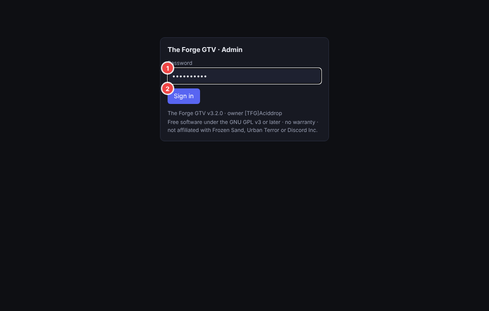

**① password ② Sign in.** You land on the Dashboard. The *Getting started* list ticks itself off as you go:

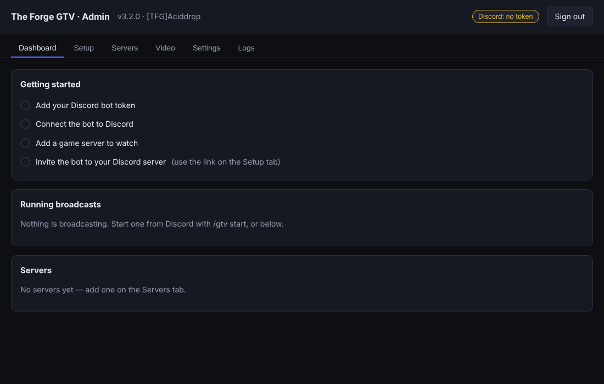

**Server with no screen or browser (the usual case):** from **your own computer** open a tunnel, leave it running, and
browse to `http://127.0.0.1:8787/` on your computer.

```bash
ssh -L 8787:127.0.0.1:8787 you@your-server
```

By default the panel answers on the bot's own machine only (`127.0.0.1`), which is the safest setting.

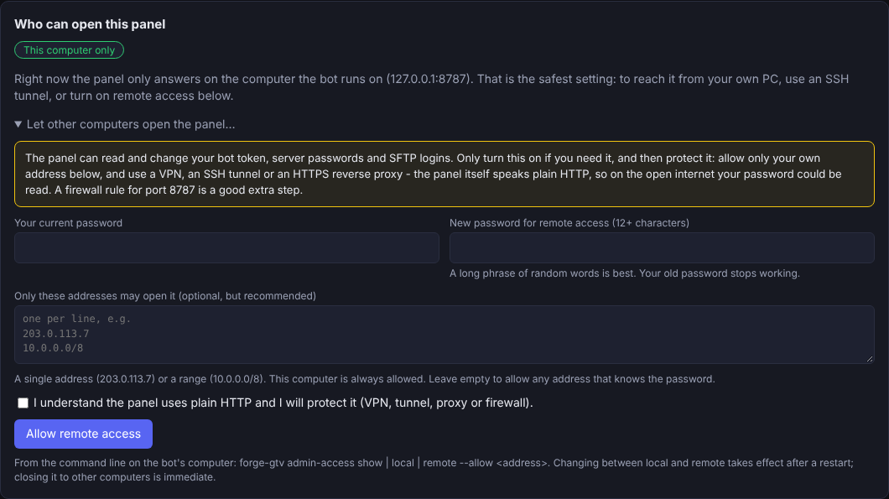

**Want to open it straight from your own computer, without a tunnel?** Switch on *remote access*: panel →
**Settings → Who can open this panel → Let other computers open the panel…** (or, on the server,
`forge-gtv admin-access remote --allow <your-address>` and then `forge-gtv restart`). You must type your password again and
choose a **new password of 12+ characters**; list your own address(es) so nobody else can even try. The panel speaks plain
HTTP, so use it over a VPN, an SSH tunnel or an HTTPS reverse proxy, and don't forward port 8787 on your router. To undo it:
**Back to this computer only** (takes effect at once), or `forge-gtv admin-access local`.

## 5. Connect the bot to Discord

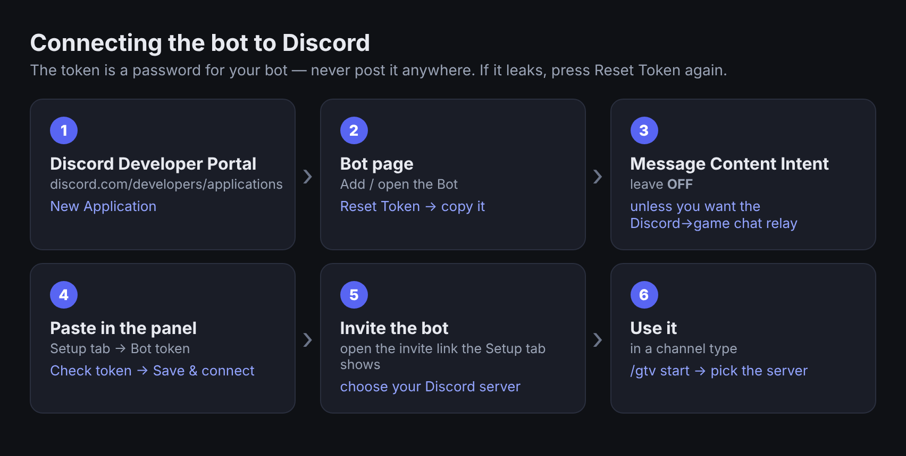

1. In the [Discord Developer Portal](https://discord.com/developers/applications): *New Application → Bot → Reset Token → copy*.
   Leave **Message Content Intent OFF** unless you want the Discord→game chat relay.
2. In the panel open **Setup**:

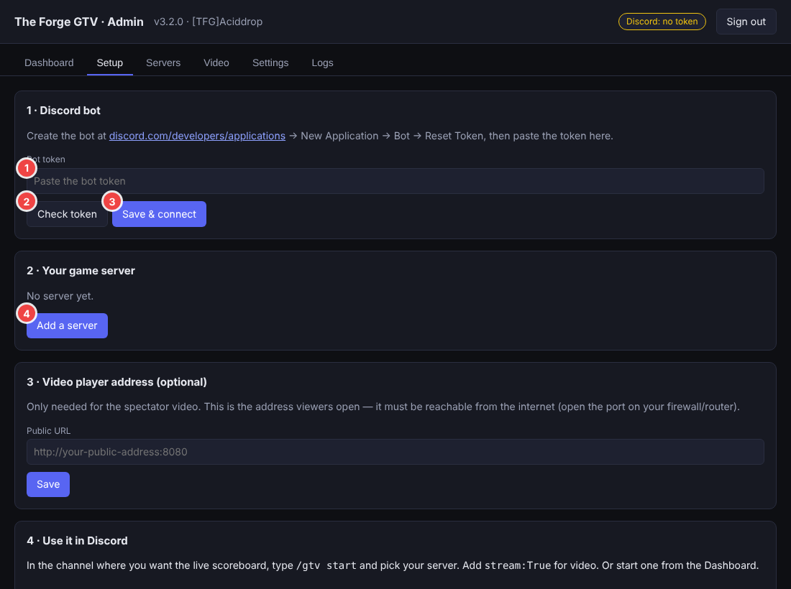

   **① paste the token → ② Check token** (shows the bot's name) **→ ③ Save & connect.** The header badge changes
   from "Discord: no token" to connected.
3. The Setup tab now shows an **invite link**. Open it and add the bot to your Discord server.
4. The `/gtv` commands need the **Manage Server** permission (you can restrict them to named user IDs in *Settings*).

## 6. Add your game server and the live kill feed

**Servers → + Add server** (or **④ Add a server** on Setup).

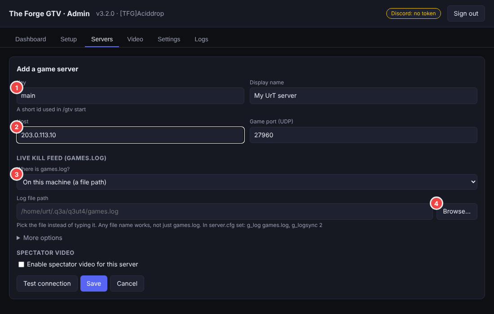

* **① Key** — a short name (`main`). **② Host** — the game server's IP or name; the port is 27960 unless you changed it.
* **③ Where is games.log?**
  * *None* — scoreboard only, no kill feed.
  * *On this machine* — the game server runs here. Use **④ Browse…**.
  * *On another machine (over SFTP)* — pick a saved SSH login or **+ New SSH connection…**, then **Browse…** on the remote machine.
* Press **Test connection** → it should say `UDP status ok`. Then **Save**.

### Use Browse… instead of typing

Folders open on click; pick the file with **④ Choose this file** (or double-click). No typing means no typos.
**③** filters the list by name.

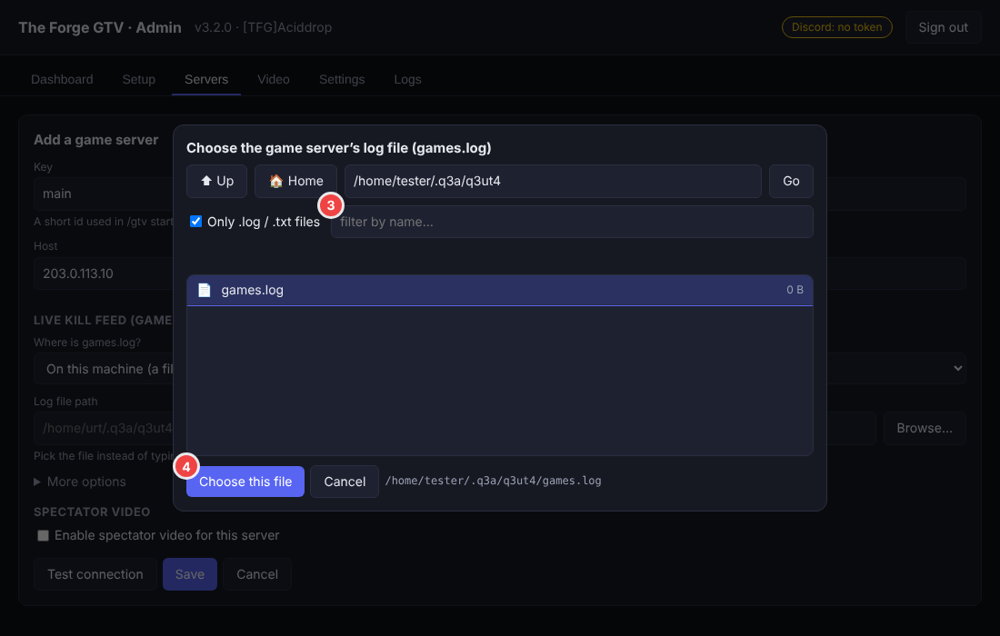

If you type a path whose folder is misspelled, the picker offers the folder it thinks you meant. It only lists
names; it never opens file contents. For SFTP the first connection shows the host's fingerprint for you to approve; a
**key file** (`chmod 600`, readable by the bot's user) is safer than a password.

## 7. Prepare the Urban Terror server

In the game server's `server.cfg`:

```
set g_log "games.log"
set g_logsync "2"        // 2 = continuous: every line is written at once, so the kill feed is live
set g_loghits "1"        // needed for headshot markers
```

`g_logsync` **must be 2**; restart the map/server afterwards. `games.log` is normally `~/.q3a/q3ut4/games.log` of the user
running the game server.

* **Same machine:** the bot's user must be able to **read** it. If the game server runs as another user, run
  `chmod o+r` on the file (or share a group), or use SFTP with that user's login.
* **Different machine:** use SFTP (Part 6).

**Now in Discord**, in the channel for the scoreboard, type **`/gtv start`** and pick the server. Add `stream:True` for
video (Part 8). Use `/gtv stop` to end it.

---

## 8. Spectator video (optional)

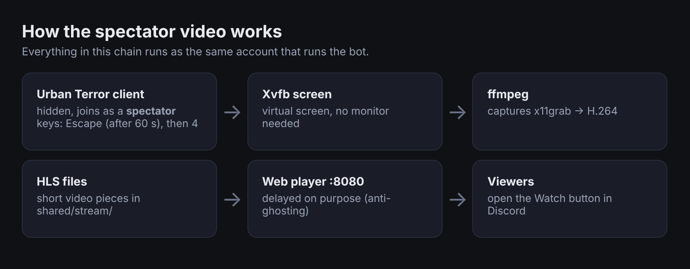

A hidden Urban Terror client joins your server as a **spectator** (it never picks a team), ffmpeg records it, and the
bot serves a web player to your viewers — delayed on purpose so nobody can use it for ghosting.

**Install the tools** - the installer offers this (Part 3, question 5), or run it any time:

```bash
forge-gtv install-video-deps          # asks first; uses sudo if you are not root
```

It installs **Xvfb** (the virtual screen - this is what makes it work *headless*, on a server with no monitor or desktop),
**xdotool** (presses the camera keys), **ffmpeg**, and the libraries the game client loads (software OpenGL, SDL 1.2,
OpenAL). Debian/Ubuntu (`apt-get`) was tried for real; Fedora/RHEL, Arch and openSUSE use the package names below but were
not run here. By hand:

```bash
# Debian / Ubuntu
sudo apt-get install ffmpeg xvfb xdotool libgl1-mesa-dri libsdl1.2debian libopenal1
# Fedora (ffmpeg comes from RPM Fusion: https://rpmfusion.org/Configuration - Fedora's own build has no H.264 encoder)
sudo dnf install ffmpeg xorg-x11-server-Xvfb xdotool mesa-dri-drivers SDL openal-soft
# Arch
sudo pacman -S --needed ffmpeg xorg-server-xvfb xdotool mesa sdl12-compat openal
```

`ffmpeg` must be a *full* build (snap/"minimal" builds often lack the screen-capture input; the Video check says so).
Then install the Urban Terror **client** and its game files somewhere the bot's user can read and run, e.g. `~/UrbanTerror43/`.

**Turn it on** — *Servers → edit → ☑ Enable spectator video for this server*:

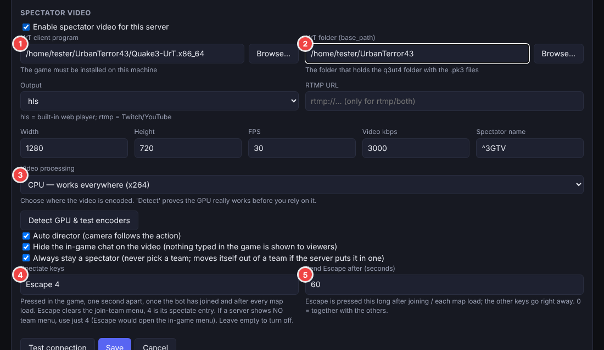

1. **UrT client program** — **Browse…** to the `Quake3-UrT…` file.
2. **UrT folder (base_path)** — the folder that contains `q3ut4/` with the `.pk3` files (filled in for you when you pick the program).
3. **Video processing** — leave **CPU**. **Detect GPU & test encoders** runs a real test encode and recommends something (press **Use this**).
4. **Spectate keys** — default `Escape 4`. *Escape* clears the "join a team" menu, *4* is the spectate entry. If your
   server has **no** team menu, use just `4` (Escape would open the in-game menu).
5. **Send Escape after (seconds)** — default 60. Escape is sent that long after joining and after each map load; the
   other keys go out right away. `0` = all together.
6. Leave **Hide the in-game chat on the video** ticked: the hidden client then shows no public or team chat and no console
   notices, so nothing typed in the game reaches viewers. (Game chat is also never posted in the Discord live feed.)
7. Leave **Always stay a spectator** ticked (the bot moves itself out of a team if the server puts it in one).

**Turn on the web player and set its public address** — *Settings → Video web player*:

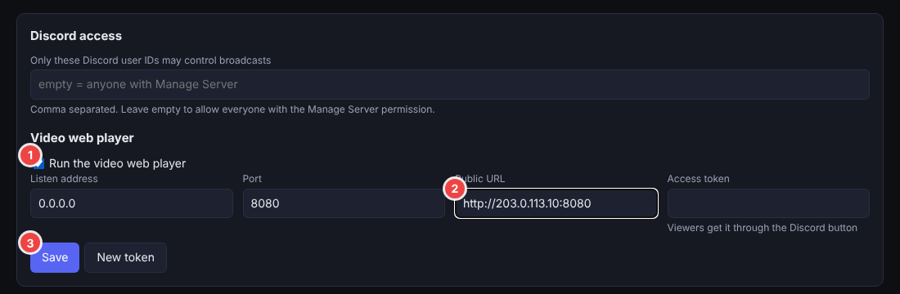

**① Run the video web player · ② Public URL** (the address your viewers will open, e.g. `http://your-public-address:8080`)
**· ③ Save.** Without ① the Video check reports *"output is hls but there is no web section"* (the screenshot below shows it).

**Check it** — *Video → Run video check* walks the whole pipeline and names the first thing that is wrong:

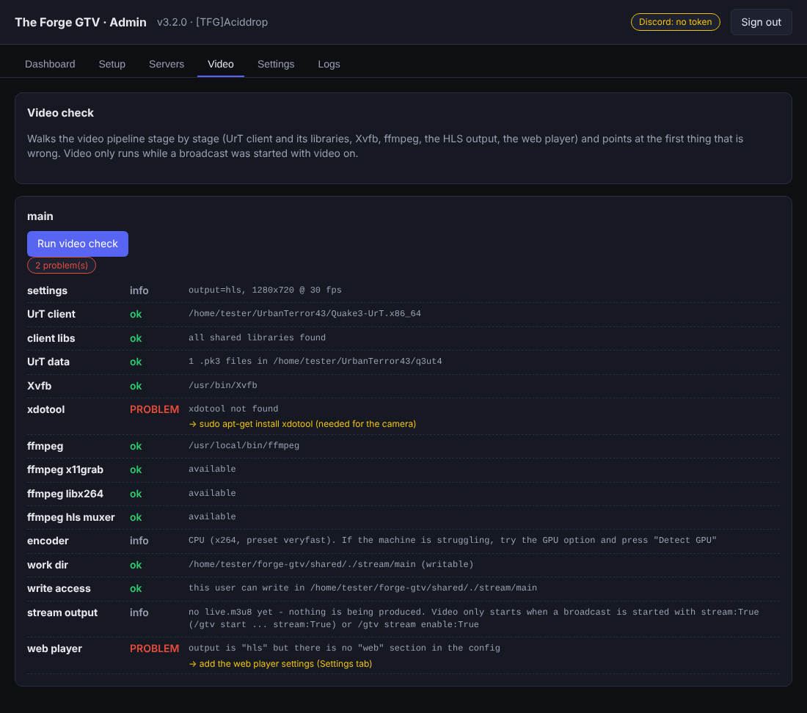

Every row is a stage; each **PROBLEM** has a yellow "→ fix" hint. (A real result from a machine that did not have `xdotool`
installed and had not yet switched the web player on.) Then start with `/gtv start … stream:True`.

### Letting viewers in — the one port that matters

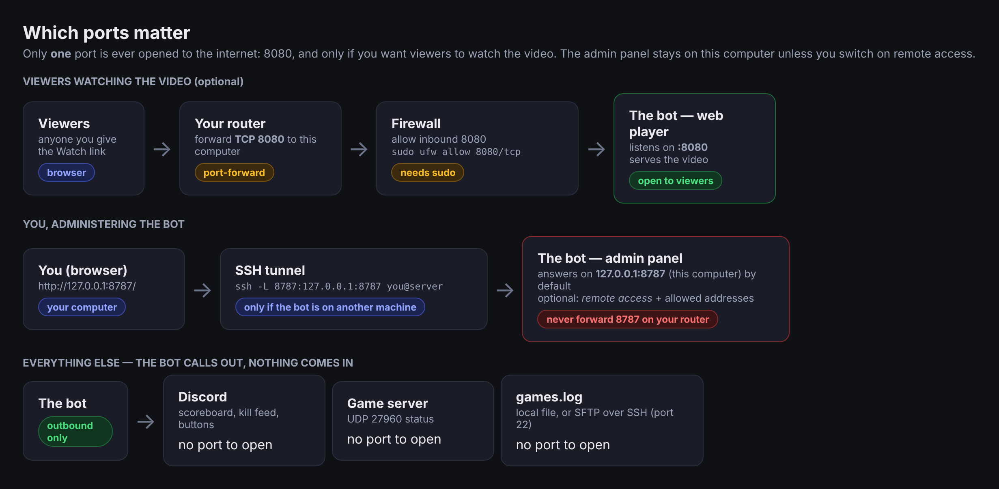

* Open **8080/tcp** (needs root): `sudo ufw allow 8080/tcp` (Ubuntu) or
  `sudo firewall-cmd --permanent --add-port=8080/tcp && sudo firewall-cmd --reload`.
* Friends outside your network also need your **router** to forward TCP 8080 to this machine. A LAN address such as
  `http://10.0.0.5:8080` works only for people on the same network (the Video check tells you).
* **8787** (the admin panel) stays closed on your router and firewall. If you switched on remote access, open it only to your own address (or reach it through a VPN / SSH tunnel).

### Streaming several servers at once *(new in 3.4.0)*

You do **not** have to stop one broadcast to start another. In Discord type `/gtv start` once per game server — in different
channels, or all in the same channel (each gets its own scoreboard and feed, with the server's name in the title). Add
`stream:True` to each one that should have video; every video runs its own virtual screen, game client and encoder.
`/gtv list` shows everything that is running. With more than one server in a channel, add `server:<key>` to `/gtv stop`,
`/gtv delay`, `/gtv stream` and `/gtv cam`; `/gtv stop all:True` ends the whole channel.

**A different web port for each server (optional).** By default all videos use the one player port (8080). To give a server
a port of its own: *Servers → edit the server → Spectator video → **Player port for this server*** — for example `8081` for one
server and `8082` for the next — then **Save**. The port opens when that server's video starts and closes when it stops; the
Watch button in Discord points at it by itself. Open each port the same way as 8080:

```bash
sudo ufw allow 8081:8082/tcp          # Ubuntu; with firewalld: --add-port=8081-8082/tcp
```

(and forward the same ports on your router for viewers outside your network). If viewers reach a server's player under another
address — a reverse proxy, say — fill in **Player address for this server**. Leave both empty to keep using the shared port.

Things to know: every video needs a share of the CPU (roughly one to two cores each at 720p30 with CPU encoding — an estimate,
not measured; the GPU option or a lower resolution/frame rate reduces it). Keep the default silent audio; two videos with real
PulseAudio sound need a separate sink each. *Settings → Configuration problems* (or `forge-gtv check-config`) names a port used
twice, or two servers that would write their video to the same place.

### Map pictures in the scoreboard *(new in 3.5.0)*

The scoreboard shows the level picture of the map being played, cut to one square (320 × 320 by default, so several
broadcasts in one channel stay tidy). Nothing to install: the bot reads the picture from the game folder of your video client
(`q3ut4`, loose `<map>.jpg` files or the maps' `.pk3` files), or from *Servers → edit → More options → **Map pictures folder*** (press **Browse…** to pick it)
if the game is on another machine. Discord fetches the picture from your web address, so **Settings → Public URL must be set**
(the same address the logo uses; port 8080 open as above). Test it in *Branding → Map pictures → Find the picture*. Size
(128–640) and *crop / pad* are on the same card. The picture shows a few seconds after a map starts; a map without one shows none.

### Permissions for video — user vs sudo

* Everything in video runs as the **service's user** (you, in both A and B). It must be able to *write* in
  `shared/stream/` (the installer prepared it) and *read/execute* the game client and its files.
* **GPU encoding (Intel/AMD, VAAPI):** the bot's user must be allowed to open `/dev/dri/renderD*`. If detection says
  "cannot open": `sudo usermod -aG render,video "$USER"`, then restart (user service: log out and in, or
  `systemctl --user restart forge-gtv`). NVIDIA (NVENC) needs only the driver (`nvidia-smi` must work).
* **"the X display is not reachable" / client restarts every 30 s:** Xvfb is missing, or an old `/tmp/.X<n>-lock` /
  `/tmp/.X11-unix/X<n>` left by an earlier run **with sudo** belongs to root. The bot skips such display numbers by itself
  and prints Xvfb's last lines in the log. To clean up manually (only if no desktop session is running here):
  `sudo rm -f /tmp/.X*-lock /tmp/.X11-unix/X*`, and check `which Xvfb`.
* `libEGL warning: failed to open /dev/dri/card0: Permission denied` in the Xvfb log is **harmless** (no GPU on a virtual screen).

### Admin commands from Discord — rcon *(new in 3.6.0, now `/gtv rcon` since 3.6.1)*

Off until you switch it on. In the panel: **Servers → edit → More options** — enter the server's **rcon password** and tick *Let the
Discord server-admin role run rcon commands* (it is greyed out until the password is there); then **Settings → Rcon commands from
Discord** — add the **people** who may use it (paste a Discord user id and press *Add this id*, or search by name) and/or press *Load roles from Discord* and tick an admin role, then **Save**. In Discord, those people and members of that role get
`/gtv rcon cyclemap`, `slap`, `kick`, `bigtext` and `ban` (a ban needs a reason). With more than one server switched on, you pick the server from a drop-down first (new in 3.7.0). Nothing else can be sent; answers are private to the
person who ran it. Everyone chosen can kick and ban, so keep the list small. Details and safeguards: `README.md`.

## 9. Day-to-day commands

Use the launcher in your install folder (`~/forge-gtv/forge-gtv` or `/opt/forge-gtv/forge-gtv`); alias it or add it to `PATH`.
Real output of three of them:

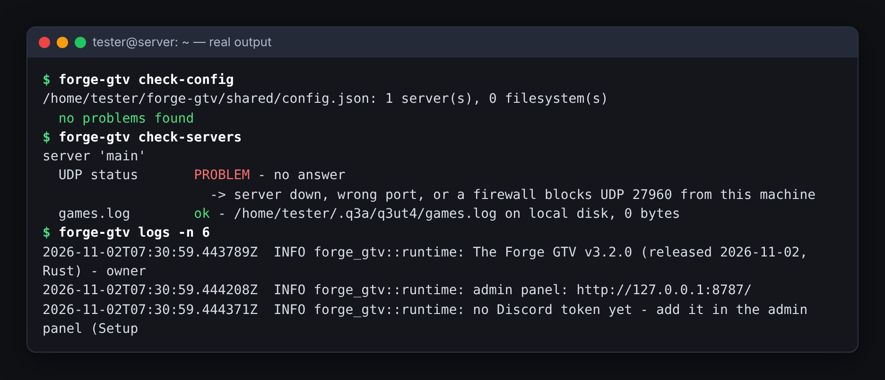

(`check-servers` reports a problem here on purpose: the example address `203.0.113.10` does not exist, so UDP gets no answer,
while the local `games.log` is found. Pointing it at your real server turns that line green.)

| Command | What it does | sudo needed? |
|---|---|---|
| `forge-gtv status` | is it running? | no |
| `forge-gtv start` / `stop` / `restart` | control the service | A: no · **B: yes** (`sudo /opt/forge-gtv/forge-gtv restart`) |
| `forge-gtv logs -n 100` / `logs -f` | show / follow the log | no |
| `forge-gtv check-config` | list configuration problems in plain words | no |
| `forge-gtv check-servers` | test the game server connections (UDP + games.log) | no |
| `forge-gtv check-stream` | walk the video pipeline | no |
| `forge-gtv check-gpu` | detect GPUs and test-encode | no |
| `forge-gtv reset-admin-password` | new panel password (printed), then restart | run it **as the service's user** |
| `forge-gtv import-config old/config.json` | copy settings from the Python version | as the service's user |

`status` says "no service is registered" with Option C — that is expected. Service output:
`journalctl --user -u forge-gtv -f` (A) or `journalctl -u forge-gtv -f` (B).

**Forgot the panel password?**

```bash
~/forge-gtv/forge-gtv reset-admin-password && ~/forge-gtv/forge-gtv restart                 # Option A
/opt/forge-gtv/forge-gtv reset-admin-password && sudo /opt/forge-gtv/forge-gtv restart      # Option B
```

## 10. Upgrade, roll back, uninstall

**Upgrade.** Run the newer installer **the same way you installed** (with `sudo` for B, without for A). It finds the
install and asks: **1) Upgrade** (keeps config, data, logs, service — recommended) · **2) Clean reinstall** (old folder
moved to `<folder>.bak-<timestamp>`) · **3) Abort**.

**Roll back:** `~/forge-gtv/forge-gtv rollback` (previous) or `… rollback 3.0.4` (named). Option B: `sudo /opt/forge-gtv/forge-gtv rollback`.

**Uninstall** (it lists what it will remove first):

```bash
~/forge-gtv/forge-gtv uninstall              # asks: keep my settings, or clean uninstall
~/forge-gtv/forge-gtv uninstall --clean      # remove EVERYTHING: service, program, settings, data, logs, folder
~/forge-gtv/forge-gtv uninstall --clean --backups --yes      # …and old .bak-* folders, no questions
```

Option B needs `sudo` (it removes `/etc/systemd/system/forge-gtv.service`). It refuses to touch a folder that is not an
The Forge GTV install and keeps any other files you put in it.

## 11. Permission rules to follow

1. **One account per install.** The service user must own `shared/` and be able to read the program (A: you own everything;
   B: root owns `releases/`, you own `shared/`).
2. **Never start the bot by hand as root** (`sudo ./forge-gtv run`) in an install that normally runs as you — it creates
   root-owned logs/stream files the service cannot write later. Use `sudo` only for service commands, installing, uninstalling.
3. **`config.json` is private (0600)** — it holds the Discord token and password hash. Do not `chmod` it open.
4. **Secrets from the environment:** put `DISCORD_TOKEN=…` (and `GTV_WEB_TOKEN=…`) in `shared/secrets.env` (`chmod 600`);
   the system service reads it automatically.
5. **Repair wrong ownership** (the usual cause of "permission denied" after mixing sudo and non-sudo):
   ```bash
   sudo chown -R "$USER": /opt/forge-gtv/shared     # Option B (use the service's user if different)
   chown -R "$USER": ~/forge-gtv/shared             # Option A (only if root once touched it)
   ```
   then `forge-gtv restart`.
6. **Open only 8080** (and only for video). Keep 8787 closed - or, if you use remote access, open it only to your own address.

## 12. Troubleshooting

| You see | Cause | Fix |
|---|---|---|
| Lines like `Failed to mkdir …/snap/firefox/…/ibus/bus`, `IBUS-WARNING`, `failed to commit changes to dconf … AppArmor` after the installer | Firefox (snap) printing its own warnings when the installer opened the panel | **Harmless - not from The Forge GTV.** Ignore them and open `http://127.0.0.1:8787/`; 3.3.1+ hides them, or use `--no-open` |
| `A system service needs root: run the installer with sudo …` | chose B without `sudo` | re-run with `sudo`, or choose the user service |
| `systemctl --user enable failed … Failed to connect to bus` | not a real login session | log in normally; or choose option 3 |
| `… overlaps the folder this installer is running from` | install folder contains the installer | run it from Downloads, install elsewhere |
| `The install directory must be an absolute path` | relative path typed | use `/opt/forge-gtv` or `~/forge-gtv` |
| `Permission denied` starting the installer | missing `chmod +x` or `noexec` mount | `chmod +x`; run from your home folder |
| Bot stops when you log out | user service without linger | `sudo loginctl enable-linger $USER` |
| Panel does not open | wrong machine/port, or bot down | `forge-gtv status`, `forge-gtv logs`; unless remote access is on it is this-machine-only → SSH tunnel (`forge-gtv admin-access show` tells you) |
| Panel says "not available from this address" | remote access is off, or your address is not in the allowed list | `forge-gtv admin-access show`; allow your address or use a tunnel |
| `address already in use` | 8787 / 8080 taken | change the port in *Settings* or stop the other program |
| `cannot read config` / `permission denied` on `shared/…` | files owned by another user | Part 11, rule 5 |
| Video check: **web player — no "web" section** | web player switched off | *Settings → Run the video web player* (Part 8) |
| Video check: **xdotool not found** | package missing | `sudo apt-get install xdotool` |
| Video check: **write access** | stream folder owned by another user | the check prints the exact `chown` |
| Log says `Disallowed gateway intents` / panel shows a yellow note about the Message Content Intent | the chat relay (Discord→game) is on for a server but the bot application does not have the *Message Content Intent* switched on | 3.5.1+ connects without the relay by itself. To use the relay: Discord Developer Portal → your application → **Bot** → Privileged Gateway Intents → switch on **Message Content Intent** → Save, then *Setup → Reconnect to Discord*. Or untick the relay on the server |
| `/gtv rcon` is not in Discord's command list | no server has it on **with** the rcon password, or no admin role is chosen, or the bot is not connected | do both parts above (the panel's *Configuration problems* says which is missing); give Discord a few seconds |
| `/gtv rcon` says *Only the people and the server-admin role chosen…* | you are not on the people list and do not hold the chosen role | add yourself in Settings → Rcon commands from Discord, or get the role (Manage Server is not enough) |
| `/gtv rcon` says *refused the rcon password* / *did not answer* | wrong `rconpassword`, or the game server is down / the address or port is wrong | compare the password with `server.cfg`; *Servers → Test connection* |
| No map picture in the scoreboard | no Public URL, no picture found for that map, or pictures switched off | *Branding → Map pictures → Find the picture* says which; set *Settings → Public URL*; point *Map pictures folder* at the folder with the `.pk3` files |
| `The player port 8081 for … cannot be used` | another program (or another server's `web_port`) already holds that port | pick a free **Player port for this server**, or `0` to share the main one; `ss -ltnp \| grep 8081` shows who has it |
| The video of server 2 opens on port 8080 / not on its own port | **Player port** left at `0`, or not saved | *Servers → edit → Player port for this server*, Save, start the video again |
| Server 2's player works on your PC but not for friends | its port is not open in the firewall / not forwarded | open and forward that port too (one per server) |
| `/gtv stop` says "Several servers are broadcasting in this channel" | more than one server in the channel | add `server:<key>`, or `/gtv stop all:True` |
| `the X display is not reachable` / restarts every 30 s | Xvfb missing, or root-owned `/tmp/.X*-lock` | Part 8, X-display bullet |
| Watch link opens, video never starts (before 3.1.4) | access cookie not sent | update to 3.1.4 or newer, open the link again |
| Video shows the team menu / bot is on a team | server's join menu | keep *Always stay a spectator*; check *Spectate keys* (Part 8) |
| `UDP status: no answer` | wrong host/port, or firewall blocks UDP | check the address; `nc -zvu host 27960` |
| `games.log … cannot be read` | wrong path, `g_log` unset, or permission | Part 7; test with **Test SSH login + log file** |
| `GLIBC_2.xx not found` | extremely old distribution | build from source (`cargo build --release`), see `README.md` |

Still stuck? Run `forge-gtv check-config`, `forge-gtv check-servers`, `forge-gtv check-stream` and `forge-gtv logs -n 100`, and send the output.

---

## License and disclaimer

The same notice is in the admin panel (*Settings → About*):

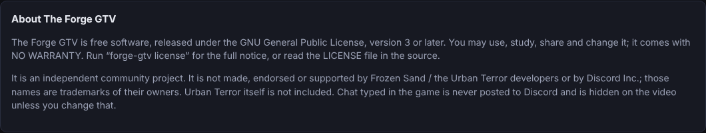

The Forge GTV is **free software** released under the **GNU General Public License, version 3 or later** (`LICENSE`; run
`forge-gtv license` to read the notice). It comes with **NO WARRANTY** — you use it at your own risk. It is an independent
community project, **not affiliated with or endorsed by** Frozen Sand / the Urban Terror developers or Discord Inc.; those names
are trademarks of their owners. Urban Terror itself is **not** included — you install the game yourself. Player chat is never
posted to Discord and is hidden on the video. Source code, contribution rules and third-party notices are in the project
repository (`README.md`, `CONTRIBUTING.md`, `THIRD-PARTY-NOTICES.md`).
