# The Forge GTV — Windows install walkthrough

**Owner: [TFG]Aciddrop** · Rust edition 3.8.0 · Windows 10 / 11 (64-bit), also Windows Server 2019+

> ## ⚠ Read this first: the Windows build is untested
> The program was written and tested on **Linux**. The Windows installer, the Task Scheduler registration, the keep-alive
> loop and the spectator video were written but have **never been compiled or run on Windows** by the author. The scoreboard,
> kill feed, admin panel and everything else that is not Windows-specific is the same code that was tested on Linux.
> Expect that something small may need a fix on first use; if so, copy the error text (or the output of
> `forge-gtv check-config`) and report it. Steps that are least certain are marked **(untested)**.
>
> **About the pictures.** The *admin-panel* pictures are real screenshots of the same web page that Windows serves (taken
> on Linux, because it is identical). The two *Command Prompt* pictures are **illustrations** drawn from the installer's
> own text, marked with an "ILLUSTRATION" ribbon — they are **not** screenshots from a Windows machine. Diagrams are drawings.
> Windows' own dialogs (SmartScreen, UAC) are described in words, not imitated.

> Looking for Linux? See `INSTALL-LINUX.md`. · Free software under the GNU GPL v3 or later, no warranty — see the end of this guide.

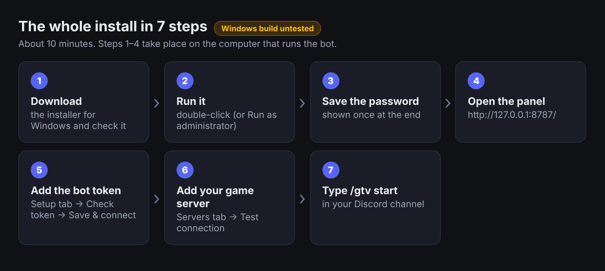

## The 10-minute path

Do steps 1–7 and skip anything marked *(more)*.

| Step | Do this | Administrator? |
|---|---|---|
| 1 | Pick how to install (Part 1) | – |
| 2 | Download and check the installer (Part 2) | no |
| 3 | Run it (Part 3) | only for the "at start-up" choice |
| 4 | Open the panel and sign in (Part 4) | no |
| 5 | Connect Discord (Part 5) | no |
| 6 | Add your game server and kill feed (Part 6) | no |
| 7 | Prepare `server.cfg`, then in Discord type `/gtv start` (Part 7) | – |

---

## 1. Choose how to install (the only real decision)

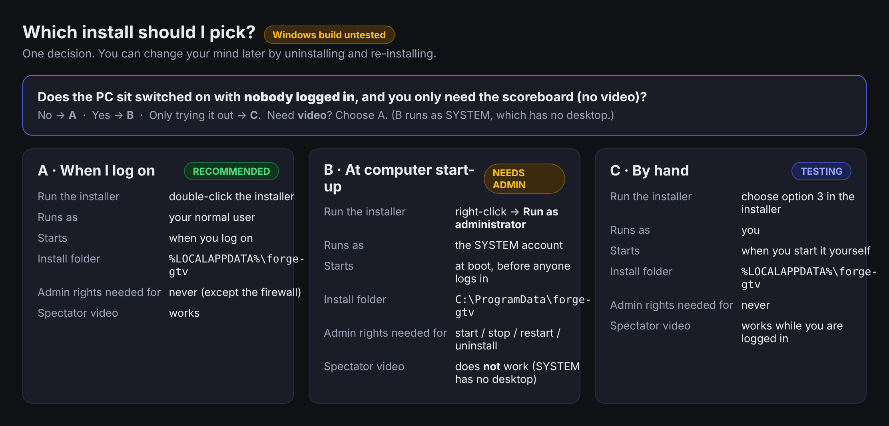

* **A — "When I log on" (recommended):** double-click the installer as a normal user. Runs as **you**. Needed for video.
* **B — "At computer start-up":** right-click → **Run as administrator**. Runs as the **SYSTEM** account at boot, before anyone
  logs on. **No video** (SYSTEM has no desktop).
* **C — "Don't register anything":** you start the bot yourself.

Key points:

* Windows shows the **UAC** question ("Do you want to allow this app to make changes?") only when you choose *Run as
  administrator*. A normal double-click never needs it.
* A start-up task can only be created by an administrator. Without admin rights the installer stops with *"could not
  create the scheduled task"*; nothing is lost — re-run it as administrator, or pick A.
* The installer makes the settings folder (`shared\`, which holds your Discord token and password hash) readable only by
  **you, administrators and SYSTEM** **(untested)**.
* One install = one owner. Do not install once as administrator and later upgrade as a normal user into the same folder.

**Requirements:** Windows 10/11 64-bit that stays switched on; the address of your Urban Terror server (IP, UDP port 27960);
a Discord account that can add a bot to your server. No Python, Rust or database needed. Video only: a full `ffmpeg`, the
Urban Terror client, and a Windows session that stays logged in and unlocked (Part 8).

## 2. Get and check the installer

1. Download `forge-gtv-setup-3.8.0-windows-x86_64.exe` (and `SHA256SUMS-windows.txt` if provided) into your **Downloads**
   folder — **not** the folder you will install to (the installer refuses that).
2. *(Recommended)* verify it in PowerShell; the hash must match the checksum file:
   ```powershell
   Get-FileHash "$env:USERPROFILE\Downloads\forge-gtv-setup-3.8.0-windows-x86_64.exe" -Algorithm SHA256
   ```
3. **SmartScreen ("Windows protected your PC").** The file is not code-signed, so Windows may warn the first time. If the
   hash matches, click **More info → Run anyway**. If the browser marks the download as blocked: right-click the file →
   **Properties** → tick **Unblock** → OK.
4. Antivirus tools sometimes flag new unsigned programs. If yours quarantines it, add an exception — or build it yourself
   (Part 12).

## 3. Run the installer

### Option A — normal user, starts when you log on

Double-click the installer (or run it from PowerShell). A console window opens. **This picture is an illustration, not a
screenshot** — the wording is the installer's own:

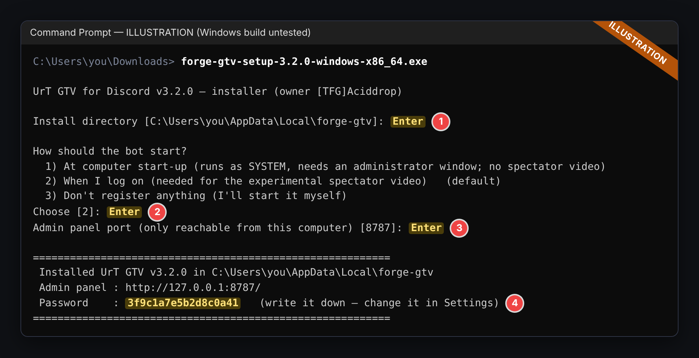

1. **Install directory** — Enter (`%LOCALAPPDATA%\forge-gtv`, e.g. `C:\Users\you\AppData\Local\forge-gtv`).
2. **How should the bot start?** — Enter for **2) When I log on** (the default when you are not an administrator).
3. **Admin panel port** — Enter for `8787`.
4. **Write the password down — it is shown once.** The window waits for Enter before it closes. If the browser does not
   open by itself, open **http://127.0.0.1:8787/**.
5. **Install ffmpeg?** *(new in 3.3.1, untested on Windows)* — only asked for the *When I log on* mode, and only if `ffmpeg`
   is not found. If `winget` exists it offers `winget install --id Gyan.FFmpeg -e`. **Windows needs no Xvfb or xdotool** (those are
   Linux tools: on Windows the game runs on your desktop and ffmpeg captures it). New programs reach the `PATH` of *new*
   sessions only, so restart the bot (or log off and on) afterwards. Without `winget` it tells you where to download a full
   build. Skip it with `--no-video-deps`; run it later with `forge-gtv install-video-deps`.

> **Harmless browser warnings in the window.** The installer opens the panel in your browser; some browsers print their own
> complaints into the same window (on Linux this shows up as `IBUS-WARNING` / `AppArmor` / `dconf` lines from a snap Firefox).
> They come from the browser, not from The Forge GTV, and change nothing. Ignore them and open `http://127.0.0.1:8787/`
> (version 3.3.1+ hides the browser's output; with an older installer add `--no-open`).

What happens **(untested)**: it copies itself to `…\forge-gtv\releases\<version>\forge-gtv.exe`, creates the launcher
`forge-gtv.cmd`, writes `shared\config.json` with a generated password, restricts `shared\` with `icacls`, registers a Task
Scheduler task **The Forge GTV** that runs `forge-gtv.exe supervise` at your logon (only while you are logged on), and starts it.

**"Access is denied" when it registers the task** (some policies allow logon tasks only for administrators): re-run the
installer **as administrator** and choose option 2 again — the task still runs as *you*. Fallback: option 3 plus a Startup shortcut (below).

### Option B — administrator, starts with the computer *(more)*

1. Right-click the installer → **Run as administrator** → **Yes** on the UAC prompt (or run it in an *administrator* PowerShell).
2. Defaults are now `C:\ProgramData\forge-gtv` and **1) At computer start-up**:

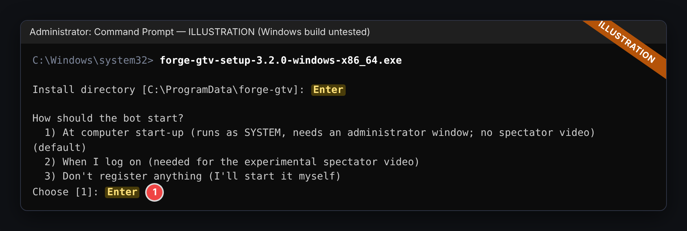

3. It creates the task **The Forge GTV** running `forge-gtv.exe supervise` at boot as **SYSTEM** with highest privileges, then starts it **(untested)**.

Notes for B: SYSTEM has no desktop → **spectator video cannot work**; scoreboard, kill feed, summaries and the panel work
normally. `C:\ProgramData` is shared by all users, so `shared\` is locked down to administrators, SYSTEM and the installing
account. Anything that controls the task (`forge-gtv start/stop/restart/uninstall`) needs an **administrator** window.

### Option C — no automatic start *(more)*

Choose **3) Don't register anything** and start the bot when you want (leave the window open; **Ctrl+C** stops it cleanly):

```bat
"%LOCALAPPDATA%\forge-gtv\forge-gtv.cmd" run
```

**Start it automatically without Task Scheduler (no administrator needed):** press **Win + R**, type `shell:startup`, Enter;
create a shortcut there with the target `"%LOCALAPPDATA%\forge-gtv\forge-gtv.cmd" supervise` and set *Run* to **Minimized**
(`supervise` keeps the bot alive and lets the panel's Restart button work).

### Unattended install *(more)*

```powershell
.\forge-gtv-setup-3.8.0-windows-x86_64.exe install --yes --service logon --password "a-long-password" --no-open
# administrator PowerShell:
.\forge-gtv-setup-3.8.0-windows-x86_64.exe install --yes --service startup --dir "C:\ProgramData\forge-gtv" --password "a-long-password" --no-open
.\forge-gtv-setup-3.8.0-windows-x86_64.exe install --dry-run --yes --service logon     # show, change nothing
```

Options: `--dir`, `--service startup|logon|none`, `--admin-port N`, `--password P`, `--existing upgrade|clean|fresh`, `--no-video-deps`,
`--no-open`, `--dry-run`, `--yes`. Without `--password` a random one is generated and printed once.

## 4. Open the admin panel and sign in

Open **http://127.0.0.1:8787/** in a browser **on this PC**.

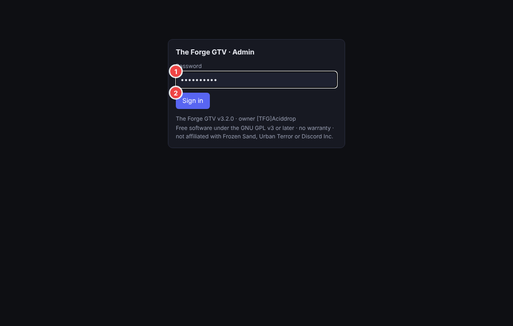

**① password ② Sign in.** You land on the Dashboard; the *Getting started* list ticks itself off as you go:

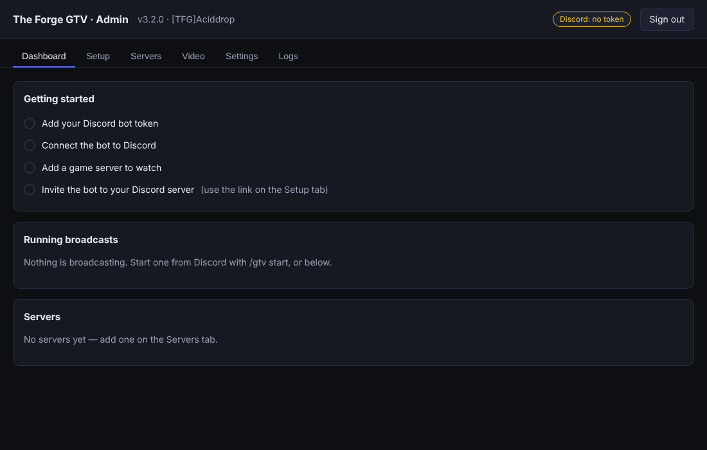

By default the panel answers on this PC only (`127.0.0.1`), which is the safest setting. To reach it from another computer
use **Remote Desktop**, or an SSH tunnel (`ssh -L 8787:127.0.0.1:8787 you@this-pc`, which needs the *OpenSSH Server* Windows
feature).

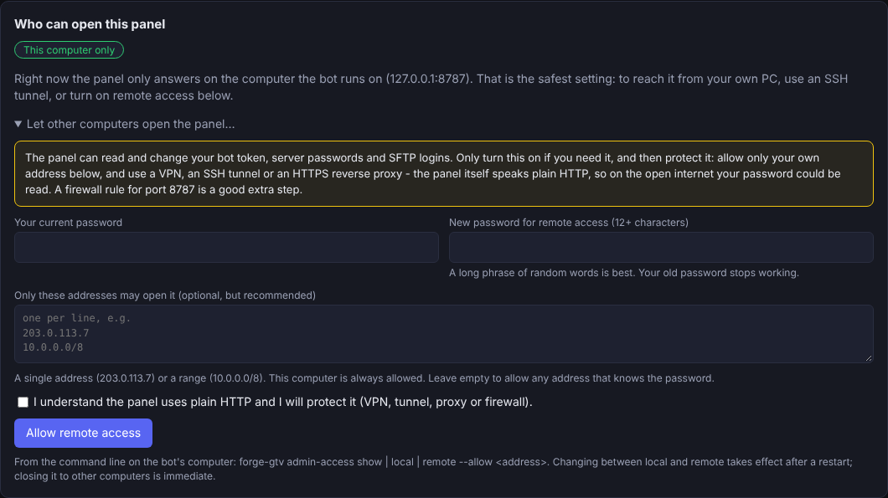

**Or switch on *remote access*** (untested on Windows like everything else here): panel → **Settings → Who can open this
panel → Let other computers open the panel…**. You type your password again and choose a **new password of 12+ characters**;
list your own address(es) so nobody else can try. Then restart (`forge-gtv restart`) and allow `forge-gtv.exe` on
**Private networks** in the firewall prompt. The panel uses plain HTTP: use it over a VPN or on your home network only, never
forward port 8787 on your router. To undo it: **Back to this computer only**, or `forge-gtv admin-access local`.

**Windows Firewall prompt.** The first time the program listens, Windows may ask whether to allow `forge-gtv.exe`. For the
panel it does not matter while it is local only: allow **Private networks only**. The video player (8080) does need to be allowed
(Part 8).

## 5. Connect the bot to Discord

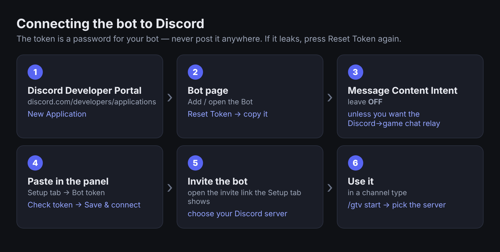

1. In the [Discord Developer Portal](https://discord.com/developers/applications): *New Application → Bot → Reset Token → copy*.
   Keep **Message Content Intent OFF** unless you want the Discord→game chat relay.
2. In the panel open **Setup**:

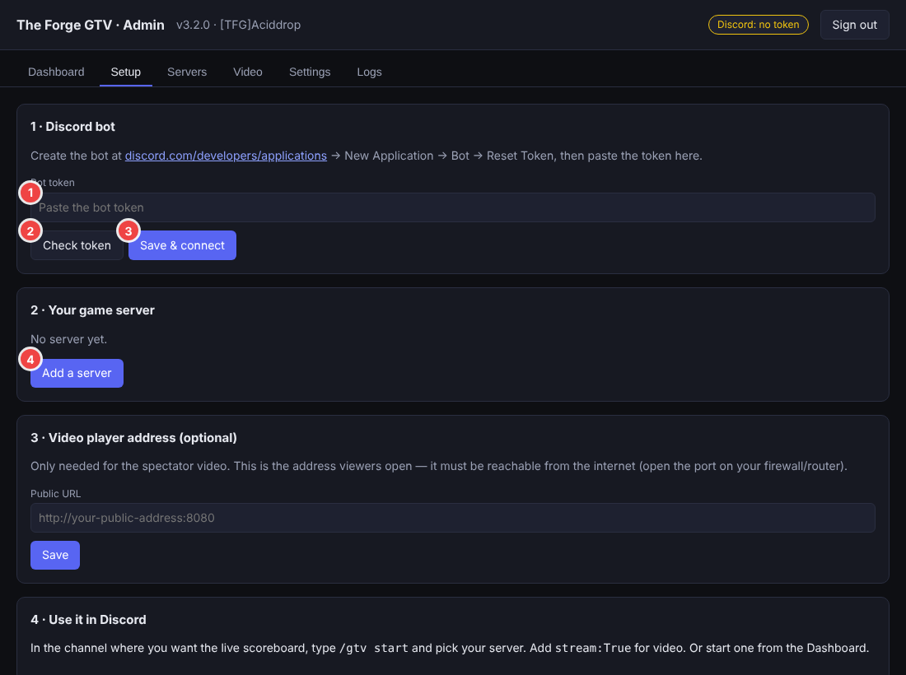

   **① paste the token → ② Check token → ③ Save & connect.**
3. Open the **invite link** that Setup shows and add the bot to your Discord server.
4. `/gtv` commands need the **Manage Server** permission in Discord.

## 6. Add your game server and the live kill feed

**Servers → + Add server** (or **④ Add a server** on Setup).

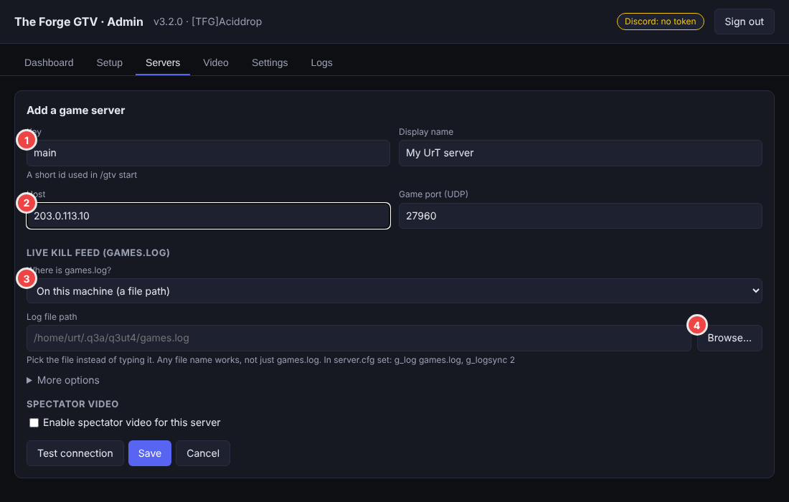

* **① Key** (`main`) · **② Host** (IP or name; port 27960) · **③ Where is games.log?**
  * *None* — scoreboard only. *On this machine* — game server on this PC, use **④ Browse…**.
  * *On another machine (over SFTP)* — pick a saved SSH login or **+ New SSH connection…**.
* **Test connection** → `UDP status ok`, then **Save**.

### Use Browse… instead of typing

On Windows the picker lists your **drives first**, then folders; click through to the file (for example
`C:\UrT\q3ut4\games.log`) and press **Choose this file**. (This picture is the same picker on Linux.)

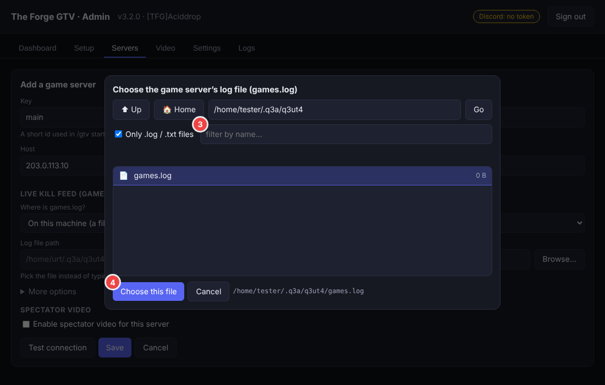

If you type a path and it is rejected, use forward slashes or doubled backslashes. For SFTP, press **Test SSH login + log file**
to confirm; the first connection shows the host's fingerprint for you to approve.

## 7. Prepare the Urban Terror server

In the game server's `server.cfg`:

```
set g_log "games.log"
set g_logsync "2"        // 2 = continuous: every line is written at once, so the kill feed is live
set g_loghits "1"        // needed for headshot markers
```

`g_logsync` **must be 2**; restart the server afterwards. If the game server runs on **this** Windows PC, the bot's account
must be able to **read** `games.log` (Option A: it is your own account; Option B: SYSTEM can read almost everything). On
another machine use SFTP with a key file or password.

**Now in Discord**, in the channel for the scoreboard, type **`/gtv start`** and pick the server. Add `stream:True` for video
(Part 8). `/gtv stop` ends it.

---

## 8. Spectator video on Windows — experimental **(untested)**

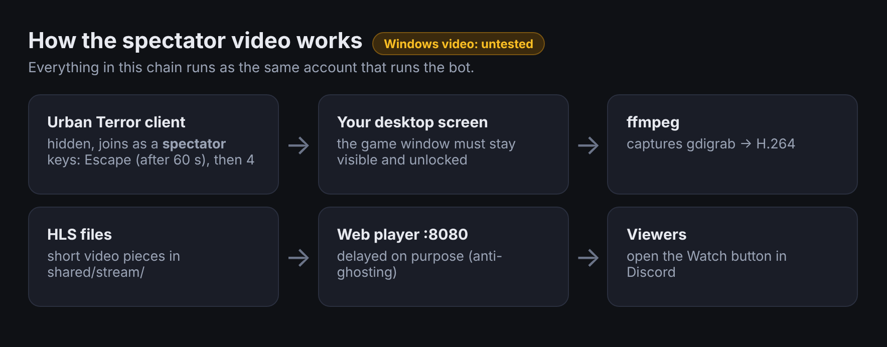

On Windows the hidden spectator is the **real Urban Terror client running on your desktop**, captured by ffmpeg
(`gdigrab`). It joins as a spectator and never picks a team. Requirements:

1. **Choose "When I log on"** (Option A). Video does not work with the SYSTEM start-up mode.
2. **Stay logged in with the screen unlocked.** Locking the PC or logging off makes the capture black or stops it
   (disconnecting a Remote Desktop session also ends the desktop — use the console or a machine/VM that keeps its session).
   Keep the game window **un-minimised**. Do not use the keyboard in that window while it runs (the camera director and the
   spectate keys are sent to it with PowerShell `SendKeys`).
3. **ffmpeg:** the installer can do this (`forge-gtv install-video-deps`, uses `winget`); or install a **full** build (for example *gyan.dev → release full*) and add its `bin` folder to `PATH`.
   `ffmpeg -devices` must list `gdigrab`, and `ffmpeg -encoders` must list `libx264`.
4. **Urban Terror client + game files** in a folder you can read and run (e.g. `C:\UrbanTerror43\`).
5. *Servers → edit → ☑ Enable spectator video* (the form below is the real panel; paths are Linux examples):

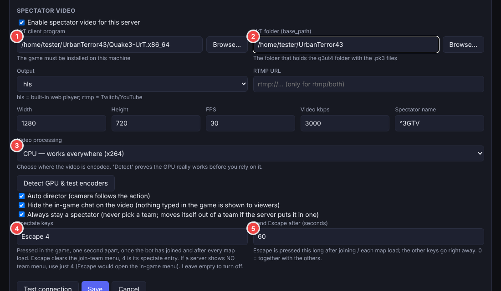

   * **① UrT client program** — **Browse…** to `C:\UrbanTerror43\Quake3-UrT.exe` (your exact file name).
   * **② UrT folder** — `C:\UrbanTerror43` (the folder that contains `q3ut4\`). Optionally set the client's **window title**
     (`window_title` in the config) so only that window is captured.
   * **③ Video processing** — *CPU* works everywhere; **Detect GPU & test encoders** also tests NVIDIA (NVENC), Intel (Quick Sync)
     and AMD (AMF) with a real encode.
   * **④ Spectate keys** default `Escape 4`: *Escape* clears the "join a team" menu, *4* is the spectate entry. On a server with
     no team menu use just `4`. **⑤ Send Escape after** 60 seconds (once after joining and after each map load).
   * Leave **Hide the in-game chat on the video** ticked so nothing typed in the game is shown to viewers. (Game chat is also never
     posted in the Discord live feed.)
6. **Turn on the web player and set its address** — *Settings → Video web player*:

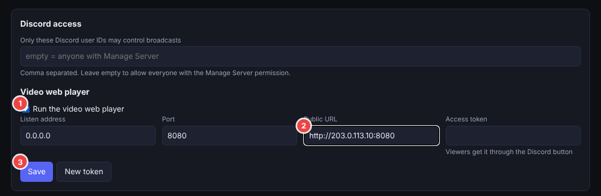

   **① Run the video web player · ② Public URL** (e.g. `http://your-public-address:8080`) **· ③ Save.**
7. **Check it** — *Video → Run video check* names the first broken stage (real screenshot from a Linux machine, so the
   rows about Xvfb/x11grab are replaced by gdigrab on Windows):

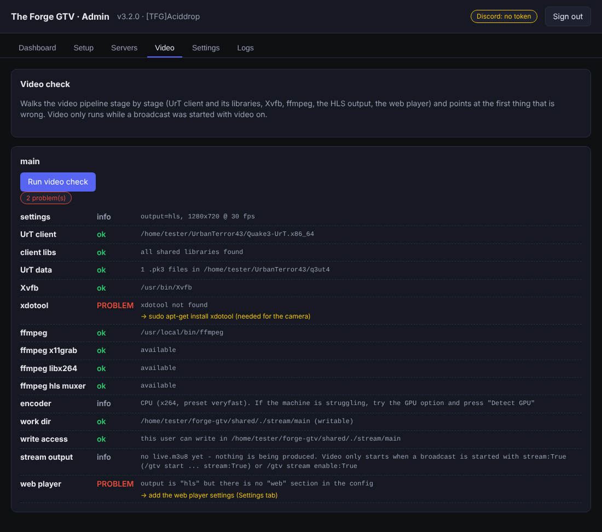

8. Start with `/gtv start … stream:True`.

### Letting viewers in — the one port that matters

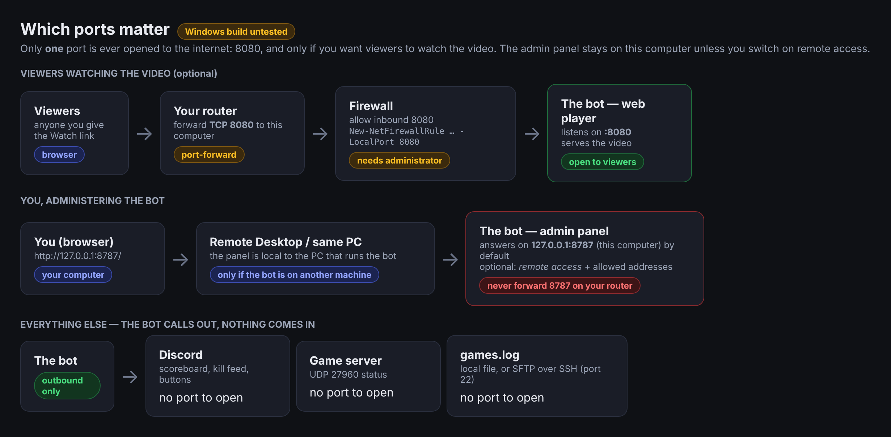

Open **8080** in Windows Firewall — this needs an **administrator** PowerShell:

```powershell
New-NetFirewallRule -DisplayName "The Forge GTV player" -Direction Inbound -Protocol TCP -LocalPort 8080 -Action Allow -Profile Private
```

Use `-Profile Any` only if viewers come over the internet. People outside your network also need a **router port-forward**
for TCP 8080. A LAN address such as `http://192.168.1.20:8080` works only on your own network. Keep 8787 (the panel) closed to the internet; it needs no router port-forward, even with remote access on.

### Several servers on Windows *(new in 3.4.0)*

Scoreboards, kill feeds and summaries work for **any number of servers at the same time**: type `/gtv start` once per server, in
different channels or in the same one (`/gtv list` shows them; add `server:<key>` to `/gtv stop`, `delay`, `stream` and `cam`
when a channel shows more than one, or `/gtv stop all:True`).

**Video for several servers at the same time is not supported on Windows.** Every game client opens on the one desktop, in the
same corner, so the pictures would cover each other. Broadcast one video at a time here (turn the video of one server off with
`/gtv stream enable:False server:<key>` before starting another's). *Settings → Configuration problems* shows a warning when
more than one server has video. Several simultaneous videos each on a port of their own — *Servers → edit → Player port for this
server* — works on **Linux**, which gives every video its own virtual screen. (You can still use a per-server port on Windows
for one video at a time; open that port in Windows Firewall like 8080. This was not run on Windows either.)

### Map pictures in the scoreboard *(new in 3.5.0 — not tried on Windows)*

The scoreboard shows the level picture of the map being played, cut to one square (320 × 320 by default). The bot reads it from
a folder on this PC: the game folder of your video client (`q3ut4`, with `<map>.jpg` files or the maps' `.pk3` files), or the
folder you give in *Servers → edit → More options → **Map pictures folder*** (press **Browse…** to pick it) (for example `C:\UrbanTerror43\q3ut4`). Discord
fetches the picture from your web address, so **Settings → Public URL must be set** and port 8080 open in Windows Firewall.
Test it in *Branding → Map pictures → Find the picture*; size (128–640) and *crop / pad* are on the same card. The picture
shows a few seconds after a map starts. The picture code is the same as on Linux and its tests passed there; it has **not** been
run on Windows.

### Admin commands from Discord — rcon *(new in 3.6.0; now as `/gtv rcon` since 3.6.1 — not tried on Windows)*

Off until you switch it on. In the panel: **Servers → edit → More options** — enter the server's **rcon password** and tick *Let the
Discord server-admin role run rcon commands* (it is greyed out until the password is there); then **Settings → Rcon commands from
Discord** — add the **people** who may use it (paste a Discord user id and press *Add this id*, or search by name) and/or press *Load roles from Discord* and tick an admin role, then **Save**. In Discord, those people and members of that role get
`/gtv rcon cyclemap`, `slap`, `kick`, `bigtext` and `ban` (a ban needs a reason). With more than one server switched on, you pick the server from a drop-down first (new in 3.7.0). Nothing else can be sent; answers are private to the
person who ran it. Everyone chosen can kick and ban, so keep the list small. Details and safeguards: `README.md`.

## 9. Day-to-day commands

Use the launcher `forge-gtv.cmd` in your install folder (`%LOCALAPPDATA%\forge-gtv` or `C:\ProgramData\forge-gtv`). Open **Command
Prompt** (or PowerShell, then type `.\forge-gtv.cmd`) in that folder, or add the folder to `PATH`.

| Command | What it does | Administrator needed? |
|---|---|---|
| `forge-gtv status` | task status | A: no · **B: yes** |
| `forge-gtv start` / `stop` / `restart` | control the task | A: no · **B: yes** |
| `forge-gtv logs -n 100` / `logs -f` | show / follow the log | no (B: readable by administrators and SYSTEM) |
| `forge-gtv check-config` | list configuration problems in plain words | no |
| `forge-gtv check-servers` | test game-server connections | no |
| `forge-gtv check-stream` | walk the video pipeline | no |
| `forge-gtv check-gpu` | detect GPUs and test-encode | no |
| `forge-gtv reset-admin-password` | new panel password (printed), then restart | same account as the install |
| `forge-gtv import-config old\config.json` | copy settings from the Python version | same account as the install |

The log is `…\forge-gtv\shared\logs\bot.log`; the task's history is in **Task Scheduler → Task Scheduler Library → The Forge GTV**.
**Forgot the password?** `forge-gtv reset-admin-password`, then `forge-gtv restart`.

## 10. Upgrade, roll back, uninstall

**Upgrade.** Run the newer installer **the same way you installed** (as administrator for B). It finds the install and asks:
**Upgrade** (keeps config, data, logs, task) · **Clean reinstall** (old folder moved to `<folder>.bak-<timestamp>`) · **Abort**.

**Roll back** (administrator window for B; re-registers the task for the older version **(untested)**):

```bat
forge-gtv rollback            :: previous version
forge-gtv rollback 3.0.4      :: a named version
```

**Uninstall** (lists what it will remove first):

```bat
forge-gtv uninstall                 :: asks: keep my settings, or clean uninstall
forge-gtv uninstall --clean         :: remove EVERYTHING: task, program, settings, data, logs, folder
forge-gtv uninstall --clean --backups --yes
```

Windows cannot delete a program while it runs; when the uninstaller *is* the installed program, the files are removed a few
seconds after the window closes **(untested)**. Option B needs an administrator window (it deletes the scheduled task).

## 11. Permission rules to follow

1. **One account per install** — a normal user (A) or the administrator + SYSTEM pair (B).
2. **Match the window to the install.** For B, open an **administrator** Command Prompt (*Start → type cmd → right-click → Run as
   administrator*) for `start/stop/restart/rollback/uninstall`. For A, use a normal window — an administrator window can create
   files your normal account then cannot change.
3. **Do not run `forge-gtv run` by hand while the task is running** (two bots on one token fight each other). Stop the task first.
4. **`shared\` holds secrets.** The installer restricts it; check with `icacls "C:\ProgramData\forge-gtv\shared"` (only SYSTEM,
   Administrators and you). To restore it (administrator window):
   ```bat
   icacls "C:\ProgramData\forge-gtv\shared" /inheritance:r /grant:r "SYSTEM:(OI)(CI)F" /grant:r "BUILTIN\Administrators:(OI)(CI)F" /grant:r "%USERNAME%:(OI)(CI)F"
   ```
5. **Don't open port 8787 to the internet.** Open only 8080 if you stream video. (Remote access to the panel, if you turn it on, is for your own network or a VPN.)
6. **Video needs a normal, logged-in desktop session**, so the task must be the "log on" kind running as you.
7. **Keep the PC awake** if it should run all day: *Settings → System → Power → Screen and sleep → Never* (a sleeping PC stops the bot and the video).

## 12. Building the installer yourself

If you have `forge-gtv-<version>-source.zip` and do not want to trust a prebuilt `.exe`:

1. Install **Rust** from <https://rustup.rs> (accept the offer to install the *Visual Studio C++ Build Tools*), then open a **new** PowerShell window.
2. Unzip the source, open the folder, double-click **`build-windows.bat`** (or run `powershell -ExecutionPolicy Bypass -File .\build-windows.ps1`).
3. It runs the tests, builds, and writes `dist\forge-gtv-setup-<version>-windows-x86_64.exe` and `dist\SHA256SUMS-windows.txt`.
   The first build downloads and compiles dependencies and takes several minutes.

Alternative: `.github/workflows/release.yml` — pushing a tag such as `v3.8.0` makes GitHub build the Windows and Linux installers.

## 13. Troubleshooting

| You see | Cause | Fix |
|---|---|---|
| Strange `IBUS` / `AppArmor` / `dconf` warning lines after the installer | a browser printing its own warnings (mostly Linux snap Firefox) | harmless, not from The Forge GTV - ignore, open `http://127.0.0.1:8787/` |
| Warning "…cannot run at the same time" about several servers with video | on Windows all game clients share one desktop | broadcast one video at a time; use Linux for several at once |
| Log says `Disallowed gateway intents` / panel shows a yellow note about the Message Content Intent | the chat relay (Discord→game) is on for a server but the bot application does not have the *Message Content Intent* switched on | 3.5.1+ connects without the relay by itself. To use the relay: Discord Developer Portal → your application → **Bot** → Privileged Gateway Intents → switch on **Message Content Intent** → Save, then *Setup → Reconnect to Discord*. Or untick the relay on the server |
| `/gtv rcon` is not in Discord's command list | no server has it on **with** the rcon password, or no admin role is chosen, or the bot is not connected | do both parts above (the panel's *Configuration problems* says which is missing); give Discord a few seconds |
| `/gtv rcon` says *Only the people and the server-admin role chosen…* | you are not on the people list and do not hold the chosen role | add yourself in Settings → Rcon commands from Discord, or get the role (Manage Server is not enough) |
| `/gtv rcon` says *refused the rcon password* / *did not answer* | wrong `rconpassword`, or the game server is down / the address or port is wrong | compare the password with `server.cfg`; *Servers → Test connection* |
| No map picture in the scoreboard | no Public URL, no picture found for that map, or pictures switched off | *Branding → Map pictures → Find the picture* says which; set *Settings → Public URL*; point *Map pictures folder* at the folder with the `.pk3` files |
| "Windows protected your PC" | unsigned program | **More info → Run anyway** (after checking the hash), or Properties → Unblock |
| The console window closes instantly | run from Explorer with no arguments | it waits for Enter; if it still vanishes, run it from PowerShell to read the message |
| `could not create the scheduled task` | start-up task without administrator rights | re-run **as administrator**, or choose *When I log on* |
| `Access is denied` creating a logon task | local policy | re-run as administrator (choose *When I log on*), or use the Startup-folder shortcut (Part 3, Option C) |
| `… overlaps the folder this installer is running from` | install folder contains the installer | run it from Downloads; install elsewhere |
| Panel does not open | task not running, port busy, or wrong URL | `forge-gtv status`, `forge-gtv logs`; use `http://127.0.0.1:8787/` (not the PC's name) |
| Panel unreachable from another PC | by default it answers on this PC only | Remote Desktop, an SSH tunnel, or turn on remote access (`forge-gtv admin-access show`) |
| Panel says "not available from this address" | remote access is off, or your address is not in the allowed list | `forge-gtv admin-access show`; allow your address |
| `address already in use` | 8787 / 8080 taken | change the port in *Settings* |
| Bot stops when you log off | logon task | by design; use Option B (no video) for a headless bot |
| Video is black | session locked, window minimised/hidden, or SYSTEM task | stay logged in and unlocked; use *When I log on* |
| Video check: **web player — no "web" section** | web player switched off | *Settings → Run the video web player* (Part 8) |
| `ffmpeg … gdigrab not available` | not a full ffmpeg build | install gyan.dev *full* and put it on `PATH` |
| Watch link opens, video never starts (before 3.1.4) | access cookie not sent | update to 3.1.4 or newer, open the link again |
| `UDP status: no answer` | wrong host/port or firewall | check the address; allow UDP 27960 on the game server |
| `games.log … cannot be read` | path wrong, `g_log` unset, or permissions | Part 7; test with **Test SSH login + log file** |
| `forge-gtv status` / `start` says *Access is denied* | Option B install, normal window | open an **administrator** Command Prompt |
| Antivirus quarantines the file | heuristic on unsigned program | add an exception, or build it yourself (Part 12) |

Still stuck? Run `forge-gtv check-config`, `forge-gtv check-servers`, `forge-gtv check-stream`, and `forge-gtv logs -n 100`, and send the
output (and your Windows version).

---

## License and disclaimer

The same notice is in the admin panel (*Settings → About*):

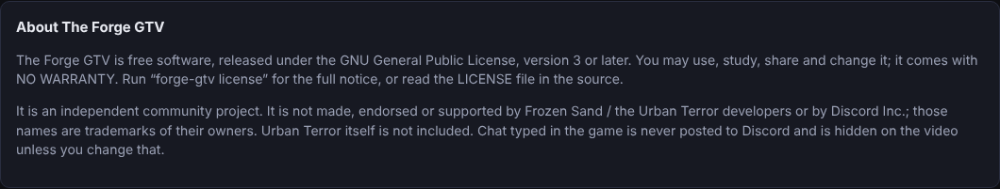

The Forge GTV is **free software** released under the **GNU General Public License, version 3 or later** (`LICENSE`; run
`forge-gtv license` to read the notice). It comes with **NO WARRANTY** — you use it at your own risk. It is an independent
community project, **not affiliated with or endorsed by** Frozen Sand / the Urban Terror developers or Discord Inc.; those names
are trademarks of their owners. Urban Terror itself is **not** included — you install the game yourself. Player chat is never
posted to Discord and is hidden on the video. Source code, contribution rules and third-party notices are in the project
repository (`README.md`, `CONTRIBUTING.md`, `THIRD-PARTY-NOTICES.md`).
