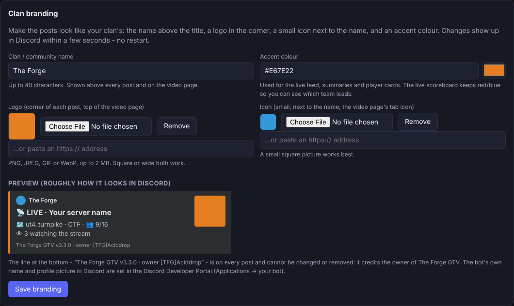
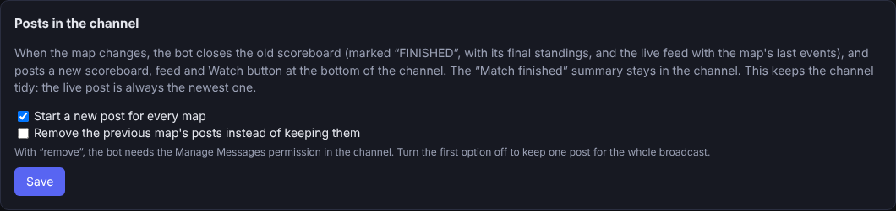
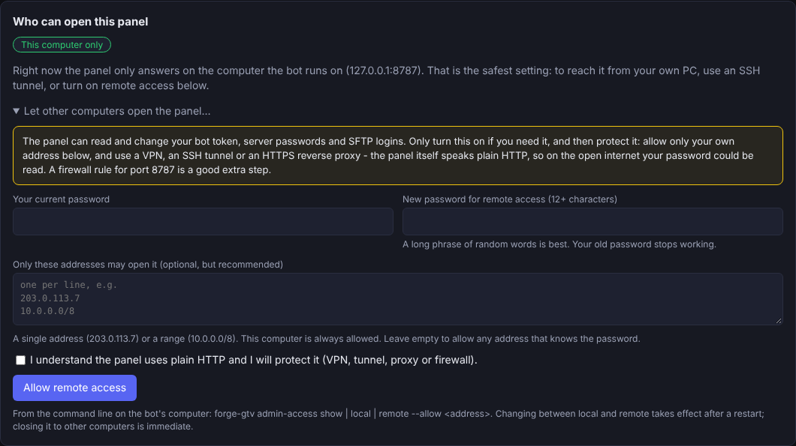

# The Forge GTV

**Broadcast an Urban Terror server into Discord** — a live scoreboard, kill feed, player cards, match summaries, an
anti-ghosting delay and (optionally) real spectator video on a web player. Written in Rust, with a built-in admin panel
and a self-installing single file for Linux and Windows.

**Free software — GNU GPL v3 or later · no warranty · independent community project.** See [License](#license-and-disclaimers).

**Step-by-step install guides (with pictures):** [`INSTALL-LINUX.md`](INSTALL-LINUX.md) (normal user or `sudo`) ·
[`INSTALL-WINDOWS.md`](INSTALL-WINDOWS.md) (normal user or administrator) · **Putting the project on GitHub:** [`GITHUB-GUIDE.md`](GITHUB-GUIDE.md)

**Owner: [TFG]Aciddrop** · Current version: see [`CHANGELOG.md`](CHANGELOG.md)

* **An admin panel** (a web page on the machine the bot runs on) walks you through the Discord bot, adds and tests as many
  game servers as you like, sets up SFTP logins for servers on other machines, checks the video pipeline, and shows the
  logs. No JSON editing needed.
* **A self-installing single file** for Linux and Windows. Run it once; it installs itself, creates a password, registers a
  service and opens the panel.
* **Privacy by default:** game chat is never posted to Discord and is hidden on the video.
* **A fresh post for every map:** when the map changes the old scoreboard is closed ("FINISHED", with its final standings)
  and a new scoreboard, live feed and **Watch** button are posted at the bottom of the channel. Optionally the old ones are
  removed instead. See [Posts, viewers and branding](#posts-viewers-and-branding).
* **Viewer count:** "👁 N watching the stream" on the scoreboard, the video page and the panel; the peak goes into the
  match summary.
* **Your clan's look:** clan name, logo, icon and colour on every post and on the video page. The ownership credit
  *"The Forge GTV vX · owner [TFG]Aciddrop"* is on every post and cannot be changed in the settings.
* **Panel access you choose:** only on the machine the bot runs on (default), or from other computers with a long password and
  an optional list of allowed addresses.

> **Status — please read.** Everything here was built and tested on Linux. **The Windows build could not be compiled or run
> in the environment it was written in.** The Windows code (installer, Task Scheduler service, `gdigrab` video, the
> `supervise` loop) is written but **untested** — see [Windows](#windows). Live Discord could not be tested either; the
> Discord layer is exercised only through a recording stand-in. Details in [What was tested](#what-was-tested).

> **Renamed.** This project was called *UrT GTV for Discord* up to 3.1.9. If you have an old install, see
> [Moving from "UrT GTV"](#moving-from-urt-gtv).

---

## 1 · Install

### Linux (x86-64)

```bash
chmod +x forge-gtv-setup-<version>-linux-x86_64
./forge-gtv-setup-<version>-linux-x86_64            # asks a few questions
sudo ./forge-gtv-setup-<version>-linux-x86_64       # same, for a system-wide service (starts at boot)
```

Unattended: `./forge-gtv-setup-… install --yes --service user --dir ~/forge-gtv`

It asks: install folder (default `/opt/forge-gtv` as root, `~/forge-gtv` otherwise), how to start
(system service / user service / don't register), and the admin panel port (default 8787). Then it prints
the panel address and a **generated password** — write it down (change it later in *Settings*).

Run it from a separate folder such as Downloads — it refuses to install into the folder it is running from.

### Windows (x86-64)

Build the installer once with `build-windows.bat` (see [Building](#building)) or take it from CI, then
double-click `forge-gtv-setup-<version>-windows-x86_64.exe`. Choose *at start-up* (runs as SYSTEM, no video) or
*when I log on* (needed for the experimental video). Run it as administrator for the start-up service.

### What the installer creates

```
<install dir>/
  forge-gtv            launcher  (forge-gtv.cmd on Windows):  forge-gtv status | restart | stop | logs | rollback | uninstall
  current  ->  releases/<version>          the active version
  releases/<version>/forge-gtv               every installed version (rollback = switch `current`)
  shared/config.json                   your settings (private, mode 0600)   ← survives upgrades
  shared/data/  shared/logs/  shared/stream/
```

**Upgrade:** run a newer installer and choose *Upgrade* — config, data and logs are kept, the old version
stays in `releases/` for `forge-gtv rollback`. **Clean reinstall** moves the old folder aside to
`<dir>.bak-<timestamp>`. **Uninstall:** `forge-gtv uninstall` asks whether to keep your settings; `forge-gtv uninstall --clean` removes everything (service, program, settings, data, logs and the folder; `--backups` also deletes the `.bak-*` folders; `--yes` skips the questions).

---

## 2 · The admin panel

Open `http://127.0.0.1:8787/` **on the machine the bot runs on** and sign in with the generated password.
By default it answers on that machine only. To reach it from your own computer, either use an SSH tunnel
(`ssh -L 8787:127.0.0.1:8787 you@box` — the safest way) or switch on **remote access** (*Settings → Who can open this
panel*, or `forge-gtv admin-access remote`); see [Remote access to the panel](#remote-access-to-the-panel) and
[Security](#security).

| Tab | What it does |
|---|---|
| **Dashboard** | Getting-started checklist, running broadcasts (stop them), start a broadcast without typing a Discord command, server list with a *Test connection* button |
| **Setup** | 1 Discord bot token (check it, save & connect, invite link) · 2 your servers · 3 public URL for the video player · 4 how to use it in Discord |
| **Servers** | Add / edit / remove any number of game servers. Per server: address, RCON, `games.log` path (local or on an SFTP machine), polling, chat relay, archive folder, spectator video. **SFTP connections** card: add a login, *Test*, approve the host key |
| **Video** | Walks the video pipeline stage by stage for each server and says which stage is broken |
| **Branding** | Clan name, logo, icon and colour with a preview; one post per map (and removing old posts) |
| **Settings** | **Who can open this panel** (this computer only / remote), change password, import the Python `config.json`, reconnect to Discord, restart |
| **Logs** | Live log |

Secrets (token, RCON, passwords) are never sent back to the browser — the panel shows `********` and keeps
the stored value when you save.

**Adding several servers:** *Servers → Add server* as many times as you need. Each server has a key
(`main`, `eu-ctf`, …). Any number of servers can be broadcast **at the same time**: start each one with
`/gtv start server:<key>` — in different channels, or all in one channel (each gets its own scoreboard and feed). Starting
one never stops another. Each server's video can have its own web port; see *Several servers at once* below.

**Pick files instead of typing them:** the *games.log* path, the UrT client program and the UrT folder each have a
**Browse…** button that lists folders on this computer (or on the SSH machine) so you click to the file. A mistyped
folder gets a "did you mean …?" suggestion, and picking the client program fills in the UrT folder for you.

**Game server on another machine:** in *Servers → Add server*, set *Where is games.log?* to
*On another machine (over SFTP)*, **Browse…** to (or type) the log file's path (any path and file name works), and either pick a saved
SSH login or choose *+ New SSH connection…* and fill in host, user and password or key file. Press
**Test SSH login + log file**: it tells you separately whether the login works and whether the file exists
there. The first connection shows the host's fingerprint and asks you to approve it. Saving the server also
saves a new connection.

**"permission denied / not writable" in the Video tab:** the check now tries to write in the stream folder,
names the folder and its owner, and prints the exact `sudo chown -R <user> <folder>` to run. (Installs made with
`sudo` before v<version> created `shared/` as root while the service ran as your user; v<version> fixes that — to repair an
older install run `sudo chown -R <your user> <install dir>/shared`.)

### Posts, viewers and branding

**One post per map.** With *Branding → Start a new post for every map* on (the default; `discord.new_post_each_map`), a map
change does this in the channel: the old scoreboard is edited into its final form (title "🏁 FINISHED", last standings,
no buttons) and the old feed keeps the map's last events under a "finished" title; then a new scoreboard, a new feed and the
**Watch** button are posted at the bottom, so the live post is always the newest message. The "Match finished — top fraggers"
summary stays where it was posted. With `discord.delete_old_posts` on, the previous scoreboard and feed are *deleted* instead
(the bot then needs **Manage Messages**); the summary is kept either way. If a new post cannot be made (missing permission),
the bot keeps using the old ones. Turn the option off for one post for the whole broadcast, as in earlier versions. A map
change right after the bot starts (nothing has happened yet) reuses the first posts.

**Viewer count.** Each open video page reports in every few seconds with a random id it makes up for that browser tab (no
address, no account, nothing stored on disk - the bot only keeps the list in memory for a few seconds). The scoreboard shows
"👁 N watching the stream" while a video is running, the panel's Dashboard shows the count (and how many have the page open
but are not playing yet, for example waiting for the anti-ghosting delay), and the match summary shows the peak.
Only viewers who have the access key (the Watch link) are counted.

**Branding.** *Branding* tab (or the `branding` section of `config.json`):

| Setting | Meaning |
|---|---|
| `branding.name` | Clan / community name, up to 40 characters. Shown above the title of every post and above the video player. |
| `branding.logo` | Logo: a picture you upload in the panel, or an `https://` address. Top-right corner of each post, top of the video page. |
| `branding.icon` | Small icon: next to the clan name, and the video page's tab icon. |
| `branding.color` | Accent colour `#RRGGBB` for the feed, summaries and player cards. The live scoreboard keeps red/blue (leading team). |

Pictures: PNG, JPEG, GIF or WebP up to 2 MB (checked by their content, never by file name; SVG is refused). Uploaded
pictures are kept in `data/brand/` and served by the video web player at `/brand/<name>` - Discord's servers fetch them from
there, so **`web.public_url` must be an address reachable from the internet**, or paste the address of a picture that is
already online. Changes apply within seconds, without a restart.





**What branding cannot change:** every post carries the footer *"The Forge GTV v<version> · owner [TFG]Aciddrop"* and the
video page the same credit; no setting changes or hides it. The bot's own name and profile picture in Discord are set in the
Discord Developer Portal (your application → Bot).

### Map pictures *(new in 3.5.0)*

The scoreboard shows the **levelshot of the map that is playing** (the picture the game shows while a map loads), under the
two team tables. Every picture is cut to **one fixed square — 320 × 320 pixels by default — whatever size the original has**,
so each broadcast takes the same room in the channel and a map change never makes the post jump around. It changes
by itself with every map; a map for which no picture is found simply shows none. The logo stays in the top-right corner.

*Branding → Map pictures*, or the `levelshots` section of `config.json`:

| Setting | Meaning |
|---|---|
| `levelshots.enabled` | On by default. Off = no picture, nothing is read from disk. |
| `levelshots.size` | Side of the square in pixels, **128 – 640** (default **320**). Applies from the next scoreboard update, no restart. |
| `levelshots.fit` | `crop` (default): fill the square and trim the edges of the 4:3 original (about a quarter of the width is lost). `pad`: show the whole picture inside the square with dark bars above and below. |
| `servers.<key>.levelshot_dir` | *Servers → edit → More options → Map pictures folder.* A folder with `<map>.jpg` (also `.jpeg` / `.png` / `.tga`) files, or with `.pk3` files, or both. Empty = the game folder of that server's video client (`spectator.base_path` + `game_dir`, usually `q3ut4`). |

**Where the pictures come from.** The bot looks, in this order, for a loose file `<map>.jpg` (or `levelshots/<map>.jpg`) in the
folder, then inside the folder's `.pk3` files (the archives UrT maps ship in; files `zz-…` / later names win, as in the game),
at `levelshots/<map>.jpg` (`.jpeg`, `.png` and `.tga` also work; capital letters in names do not matter). The folder is on the
machine **the bot runs on** — it does not download anything. If the bot runs on another machine than the game, copy the
maps' `.pk3` files (or just their levelshots) to a folder there and put it in *Map pictures folder* — the **Browse…** button next to it lists the folders of the machine the bot runs on and tells you whether the folder you are in holds `.pk3` archives, pictures or a `levelshots` folder.

**It needs `web.public_url`.** Discord's servers download the picture from your web player's public address
(`<public_url>/levelshot/<file>`), exactly like the logo, so `web.public_url` must be reachable from the internet. The
configuration check says so when pictures could be found but no public address is set. Only the finished, resized files
the bot made are served (named after the map, the size and a checksum) — never your game folder.

**Check it before a match.** *Branding → Map pictures → Test: does the bot find a picture?* — pick the server, type a map
name (for example `ut4_turnpike`) and press *Find the picture*: you see the picture at its final size, the folders searched, and
the address Discord will use. The first time a map is seen the picture is made in the background, so it appears **a few
seconds after** the map starts (a miss is retried after five minutes); after that it is instant.

Limits and safety: pictures are decoded with fixed ceilings (4096 × 4096 pixels, 8 MB per file) and re-encoded as JPEG, so a
broken or hostile file is skipped, not served. Map names are reduced to letters, digits, `_` and `-`.

### Remote access to the panel

| Mode | What it means |
|---|---|
| **This computer only** (default) | The panel listens on `127.0.0.1`. Nobody else can even connect. |
| **Remote** (`admin.host` = `0.0.0.0`) | Other computers can open `http://<this computer>:8787/`. |



Switching on remote access (*Settings → Who can open this panel → Let other computers open the panel…*) asks for your current
password again and makes you choose a **new password of at least 12 characters** (the old one stops working). You can limit it
to listed addresses or ranges (`203.0.113.7`, `10.0.0.0/8`; this computer is always allowed; the panel refuses a list that would
lock out the address you are using). Closing remote access again takes effect at once; opening it needs a restart because the
panel has to listen on a different address. From the command line on the bot's computer:

```
forge-gtv admin-access show
forge-gtv admin-access remote --allow 203.0.113.7 --allow 10.0.0.0/8     # prints a new random password once
forge-gtv admin-access local
```

**Please protect it.** The panel can read and change your Discord token, game passwords and SFTP logins, and it speaks plain
HTTP: on the open internet your password can be read on the way. Keep it behind a VPN, an SSH tunnel or an HTTPS reverse proxy
(the panel then marks its cookie `Secure` when the proxy sends `X-Forwarded-Proto: https`), and add a firewall rule for the
panel port. Behind a reverse proxy on the same machine every request comes from `127.0.0.1`, so the address list cannot tell
visitors apart - let the proxy do the filtering. The settings page, the Python import and `PUT /api/config` cannot switch remote
access on by themselves.

---

## 3 · Using it in Discord

`/gtv start server:<key> [delay:<seconds>] [stream:True]` · `/gtv stop` · `/gtv delay` · `/gtv stream` ·
`/gtv cam` · `/gtv list` · `/gtv about`. The same actions exist in the panel's Dashboard.

**Several servers in one channel.** `/gtv start` once per server. When a channel shows more than one, `stop`, `delay`,
`stream` and `cam` need `server:<key>` to say which (the option autocompletes to the servers running in that channel;
with only one running it is not needed). `/gtv stop all:True` stops every broadcast in the channel. `/gtv list` shows
everything that is broadcasting in every channel — server, channel, delay, the video link and the 👁 count. The
player-card menu under each scoreboard belongs to that scoreboard's server. Chat relay (if on) goes to every server in the
channel that has `relay_chat`.

Create the bot at <https://discord.com/developers/applications> → New Application → Bot → Reset Token. Paste the
token in *Setup*. The panel gives you the invite link. Enable the **Message Content** intent only if you use
Discord→game chat relay. If you turn the relay on without that switch, Discord refuses the connection ("Disallowed gateway
intents"): since 3.5.1 the bot then connects again **without** the relay, keeps everything else working and tells you in the
panel (Dashboard / Setup) what to switch on — Developer Portal → your application → Bot → Privileged Gateway Intents →
**Message Content Intent**, save, then *Reconnect to Discord*.

### Admin commands from Discord (rcon) *(new in 3.6.0, now `/gtv rcon` since 3.6.1)*

**Off by default.** Members of **one Discord role** you choose can run five commands on the game server, and nothing else:

| Command | What it sends to the server |
|---|---|
| `/gtv rcon cyclemap` | `cyclemap` — the next map in the rotation |
| `/gtv rcon slap player:<name or number>` | `slap <client number>` |
| `/gtv rcon kick player:<…> [reason:<text>]` | `kick <client number> "<reason>"` |
| `/gtv rcon bigtext message:<text>` | `bigtext "<message>"` — large text on every screen |
| `/gtv rcon ban player:<…> reason:<text>` | `addip <the player's address>`, then `kick <client number> "Banned: <reason>"` |

**Choosing the server (new in 3.7.0).** With **two or more** game servers switched on, every `/gtv rcon` action first asks you to **pick the server
from a drop-down** (it lists only servers that have the switch on *and* a password; the choice is required, so a command can never go to
“whichever one”). With a single server there is nothing to pick. If you ever have more than 25, the field becomes a typed one with
suggestions. Example: `/gtv rcon slap server:<pick one> player:Bob`. **It is only available when all three are true:**

1. *Servers → edit → More options*: the server's **rcon password** is entered (the `rconpassword` from its `server.cfg`) **and**
   *Let the Discord server-admin role run rcon commands* is ticked. The tick box stays greyed out until a password is there.
2. *Settings → Rcon commands from Discord*: choose **who** may use it — **people**, a **role**, or both (new in 3.8.0: people).
   *People:* paste a person's Discord user id (Developer Mode on → right-click them → *Copy User ID*) and press *Add this id*: the
   bot looks the name up so you can see it is the right person; or type part of a name and press *Search members* (this needs the
   bot's **Server Members Intent** switched on in the Discord Developer Portal → your application → Bot → Privileged Gateway
   Intents; without it the search says so and adding by id still works). *Role:* press *Load roles from Discord* and tick it, or
   paste the role id (right-click the role → *Copy Role ID*). Someone is allowed when they are on the people list **or** hold a
   chosen role. Press Save.
3. The bot is connected to Discord.

Then `/gtv rcon` appears in Discord within seconds (no restart); switch the last server off, or remove every person and role, and it disappears again.

It is a group inside `/gtv`: type `/gtv`, pick **rcon**, then the action (`/gtv rcon slap …`). While it is on, Discord shows `/gtv` to
everyone (normally it is hidden from people without *Manage Server*, which would also hide it from your admin role); the other
`/gtv` sub-commands (start, stop, …) still say *You need Manage Server* to anyone without it. To hide `/gtv` from people again, use
*Server Settings → Integrations → the bot → /gtv* in Discord.

**How it is kept safe**
* **Only the people and roles you chose.** *Manage Server* is not enough, being the server owner is not enough, the guild's
  `@everyone` role is refused even if you choose it, and it does not work in direct messages. Everyone chosen (or holding a chosen
  role) can kick and ban, so keep the list and the role small. The list can only be changed in the admin panel (password), never
  from Discord itself.
* **Nothing typed is sent as a command.** You type a name or a number; the bot asks the server for its own player list
  (`status`), finds that player and sends only the **client number**. Names that fit several players are refused with the list
  ("use the number"). Reasons and messages are cut to 80 characters and lose `; " \ % $ ^ ~` and anything that is not plain
  printable text, so they cannot close the quotes or add a second command.
* **A ban is by address** — that is how Urban Terror bans (`addip`). It is refused when it could hit the wrong people: a bot, a
  player the server shows no address for, the server's own address (`127.…`), or an address that **several players share**
  (then it tells you to kick instead). Anyone else behind the banned address is blocked too. To undo it, run
  `removeip <address>` in the server's rcon — the bot's answer to you contains the exact line.
* **Private answers.** Every reply is visible only to the person who ran the command. The bot's log records who ran what (the
  player's number and name and the reason; never the address or the password). One command per person every 2 seconds.
* The rcon password is never shown again in the panel once saved, and it is only ever sent to that server's own address.

No extra Developer Portal setting is needed (the role comes with the command itself; it is **not** the Message Content
intent). `/gtv rcon` replies "did not answer" if the server is down and "refused the rcon password" if it is wrong.

---

## 4 · Spectator video (optional)

A headless UrT client joins as a spectator, ffmpeg captures it, and the bot serves an HLS web player
(or pushes RTMP). Per server, add a *spectator* section in the panel. Needs the UrT client, ffmpeg
and (Linux) Xvfb + xdotool; the installer offers to install them (Xvfb is the virtual screen that makes it work headless, with no monitor), or run `forge-gtv install-video-deps`; the *Video* tab tells you what is still missing.
The player page uses the hls.js copy bundled in the bot (nothing is loaded from a CDN). `web.public_url` must be an address your
viewers can reach — a LAN address like `http://10.0.0.5:8080` only works for people on that network (the
Video check says so).

### Several servers at once

Each server with video runs its **own pipeline**: its own virtual screen (Xvfb), game client, ffmpeg and camera, so any number
can be broadcast at the same time and none has to be stopped to start another. Starting the video of a server that is already
streaming (for instance in a second channel) shares that server's one pipeline.

**A web port for each server.** By default every video is served by the one web player (`web.port`, address
`/watch/<server key>`). To stream each server on a different port, give it its own in *Servers → edit → Spectator video →
Player port for this server* (`servers.<key>.spectator.web_port`, e.g. `8081`, `8082`):

```json
"servers": {
  "pub": { "host": "10.0.0.5", "port": 27960, "spectator": { "client_binary": "...", "base_path": "...", "web_port": 8081 } },
  "war": { "host": "10.0.0.5", "port": 27961, "spectator": { "client_binary": "...", "base_path": "...", "web_port": 8082 } }
}
```

* The port opens when that server's video starts and closes when it stops; nothing is listening while it is off. If the
  port is taken, the video is not started and the message names the port.
* A server's port serves **only that server's** video (the page, the status and the files of the others answer "not
  available"), under the same access key. The Watch button in Discord links to the right port by itself: your
  `web.public_url` with that server's port. If viewers reach it at another address (a reverse proxy, a different host name),
  set *Player address for this server* (`spectator.public_url`, e.g. `https://gtv2.example.com`).
* Each port must be open in your firewall / forwarded on your router, like `web.port` (see the install guides). `web_port`
  `0` (the default) means "use the shared player", so existing configs keep working.
* The configuration check names clashes in plain words: a port used twice or equal to `web.port` or the admin port, two
  servers publishing to the same `publish_to` or `rtmp_url` (they would overwrite each other), two videos with sound
  (`audio: "pulse"`) on the same `pulse_source` (they would mix — give each its own PulseAudio sink, or keep the default
  `audio: "silent"`).
* **Cost:** every video runs a game client and an encoder. As a rough guide (an estimate — not measured here) plan for one to
  two CPU cores per 720p30 stream with CPU encoding; GPU encoding, a lower resolution or a lower frame rate reduce it.
* If the second client never joins while the first works, give it its own local game port with
  `"extra_client_args": ["+set", "net_port", "27971"]` (a different number per server; not verified here with a real client).
* **Windows:** all game clients would open on the same desktop, so several videos at once are **not supported** there (the
  check warns); scoreboards for any number of servers still work. Several simultaneous videos are Linux-only.

### CPU or GPU encoding
**Spectate keys.** After the client has joined the server, and again after every map load (the game log's `InitGame`, or
a different map in the status), the bot presses keys in the game. `4` (the join-team menu's "spectate" entry) goes
once the game has settled; **Escape** (clears the menu) goes **60 seconds** after that join / map load
(`spectator.escape_delay`; `0` sends it together with the other keys, first). Escape is sent once per join / map load,
only while the client is still on the server, and never as a retry - pressed when no menu is up it opens the in-game
menu, so on a server that shows no team menu set the keys to just `4`. If the game log shows the client still on a team,
`4` is repeated every 5 s (up to 5 times). `spectator.spectate_key` holds the keys (space separated, up to 4, e.g.
`Escape 4`, `F5`); empty turns it off.

**The spectator never picks a team.** With *Always stay a spectator* on (default, `spectator.force_spectator`), once the
client is on the server the bot sends `team s` to it, and repeats every few seconds if the game log shows the client on
red/blue/free (for example because the server has `g_teamAutoJoin 1`). Without a `games.log` it is sent once per client
start. The client's own name is hidden from the scoreboard and feed.

*Servers → Spectator video → Video processing* chooses where ffmpeg encodes: **CPU** (x264, works everywhere),
**GPU automatic**, or a specific GPU encoder (NVIDIA NVENC, Intel/AMD VAAPI on Linux, Intel Quick Sync, AMD AMF on
Windows). Press **Detect GPU & test encoders** (or run `forge-gtv check-gpu`): it looks for GPUs and runs a short
real test encode with every encoder your ffmpeg has, shows how fast each ran, explains what is missing when one
fails (driver, `render` group permission, VA driver...), and recommends one that actually works — then **Use this**.
Setting `encoder` to `auto` does the same at stream start. Only the encoding moves to the GPU: the game client is
still software-rendered inside Xvfb, which is fine at 720p. The Video check re-tests whichever encoder you picked.
Encoder choice is in `servers.<key>.spectator.encoder` (`vaapi_device` selects the render node).

### Windows
Video on Windows uses `gdigrab` to capture the client window and PowerShell `SendKeys` for the camera key.
It needs an interactive logged-on desktop (so choose *when I log on*, not *at start-up*), an un-minimised UrT
window, and `window_title` set to the client's title. **This path has never been run.** The scoreboard,
kill feed and everything else do not depend on it.

---

## 5 · Command line

```
forge-gtv install [--dir D] [--service system|user|startup|logon|none] [--yes] [--admin-port N] [--password P] [--dry-run] [--existing upgrade|clean] [--no-video-deps]
forge-gtv uninstall [--clean] [--backups] [--yes]     forge-gtv rollback [VERSION]
forge-gtv start | stop | restart | status | logs [-n N] [-f]
forge-gtv check-config | check-servers [KEY] | check-stream [KEY] | check-gpu [--ffmpeg PATH]
forge-gtv install-video-deps [--yes]        (Xvfb, xdotool, ffmpeg + the client's libraries on Linux; ffmpeg via winget on Windows)
forge-gtv import-config <python config.json>
forge-gtv reset-admin-password [--password P]
forge-gtv admin-access [show|local|remote] [--allow ADDR]... [--password P]     (who can open the admin panel)
forge-gtv license [--full]        (the GNU GPL notice / the complete licence text)
forge-gtv run [--config FILE]     (what the service runs)       forge-gtv supervise     (Windows keep-alive)
```

`DISCORD_TOKEN` and `GTV_WEB_TOKEN` environment variables override the config (handy for secrets in
`shared/secrets.env`, which the systemd unit reads).

## 6 · Importing from the older Python version

Panel → *Settings → Import*, or `forge-gtv import-config old/config.json`. It copies the Discord token, allowed
users, web settings, filesystems and servers (comments in the file are fine). Keep the Python bot stopped
while this one uses the same token.

## Security

* The panel binds to `127.0.0.1` unless you switch on remote access, uses a salted, iterated password hash, throttles wrong
  passwords, and sets `HttpOnly; SameSite=Strict` cookies. Every changing request must carry an `X-Requested-With` header, and the
  first-run password form only works from this computer with a `localhost`/`127.0.0.1` Host header.
* SFTP checks `known_hosts`; unknown hosts are refused until you approve them in the panel.
* `config.json` is written atomically with a `.bak` and mode 0600.
* Remote access (`admin.host` `0.0.0.0`) exposes the panel to the network over **plain HTTP** — put it behind a VPN, an SSH
  tunnel or a reverse proxy with TLS. It needs a password of 12+ characters, can be limited to listed addresses
  (`admin.allowed_ips`), and is only switchable by someone who already knows the password (or has access to the machine:
  `forge-gtv admin-access`). Turning it off cuts other computers off immediately.
* Clan pictures are the only files the video web player serves from disk besides the video itself: fixed name pattern
  (`<16 hex>.png|jpg|gif|webp`), one folder, checked by content on upload, served with `nosniff`.
* The viewer count keeps random per-tab ids in memory for a few seconds - no IP addresses, nothing on disk.

## Building

```bash
cargo test && cargo build --release                  # Linux binary: target/release/forge-gtv
tools/release.sh                                    # tests + portable build + dist/ + SHA256SUMS
```
Windows: install Rust (rustup), then run `build-windows.bat` → `dist\forge-gtv-setup-<version>-windows-x86_64.exe`.
CI: `.github/workflows/release.yml` builds and tests both on GitHub when a `v*` tag is pushed.

## What was tested

| Area | How |
|---|---|
| Config, games.log parser, UrT UDP protocol, HLS delay, watch engine (scoreboard/feed/cards/summary) | unit tests |
| Admin API: login, throttling, CSRF header, first-run rules, secret masking round trip, server CRUD, UDP test, import | HTTP tests against the real router |
| Installer: fresh / upgrade / clean / same-version / unfinished / rollback / dry-run / refusal inside own folder, systemd unit, uninstall | tests + a real install into a temp dir, then the installed binary was run and driven over HTTP with a fake game server |
| SFTP: host-key refusal, learn, read, write, nested dirs, remove | against a real `sshd` on localhost |
| GPU encoders | argv per encoder, detection logic with a stand-in ffmpeg (NVENC/QSV fail, VAAPI passes), and real ffmpeg: the CPU test passes and every GPU test fails with the right explanation on this GPU-less machine — **no real GPU was available, so NVENC/VAAPI/QSV/AMF were never run on hardware** |
| Video pipeline | fake client/ffmpeg binaries (process supervision, argv, failure explanations) — **not** a real UrT client |
| Several servers at once | tests with the recording stand-in: two servers in one channel (separate scoreboards/feeds, commands that need `server:`, stopping one leaves the other), one server in two channels; **real TCP sockets**: each server's own port serves only its own stream (another server's page, status and files are refused), closes with its video and reopens at once, a taken port stops the video before it starts; the real start/stop path with two videos at once using stand-in client/ffmpeg programs; the config warnings; the panel's new fields saved to `config.json` through headless Chromium |
| Map pictures | unit tests: names, exact square output for many sizes/fits, crop vs pad, hostile/oversized files refused, loose files and `.pk3` archives (any letter case, later archive wins), non-blocking cache and retry; the scoreboard test (picture present at one fixed size, absent when off or without a public address); public serving of only the files the bot made; the panel's test box; the panel/config checks. The 4-broadcast layout was drawn from the bot's real output into a Discord-style mock page (headless Chromium) with **placeholder pictures** |
| Admin commands (`/gtv rcon`) | unit tests: the player list read from the real `status` layout (names with spaces and colours, bots, connecting players); finding a player by number / exact name / part of a name and refusing ambiguous ones; **hostile reasons and messages** turned into harmless text; the exact commands each action sends; every case where a ban is refused (no reason, bot, no address, the server's own address, an address shared by several players); the role check (only the chosen role, the `@everyone` trap, no direct messages, no role chosen); when `/gtv rcon` exists at all; the command's shape. **Real UDP sockets**: a stand-in game server answering `status` in several packets, checking the password and recording exactly what the bot sends, plus wrong password / nothing listening / switched off. The three key safeguards were broken on purpose and each broke a test. The panel's switch (greyed out without the password) and role card in headless Chromium |
| Per-map posts, viewer count, branding | unit tests against the recording stand-in (new post, closing the old one, deleting, failure fallback, owner credit on every embed whatever the branding), HTTP tests of the web player (public pictures, viewer ids) |
| Remote panel access | HTTP tests (loopback/allowed/denied addresses incl. IPv6 and IPv4-mapped, password rules, lock-out guard, cut-off on switching back) **and** the real binary reached from a non-loopback address: refused outside the list, open without one |
| Picture upload | HTTP tests (type by content, SVG/exe/empty/oversize refused, replace + cleanup) and a real upload through Chromium |
| Video-tools installer step | unit tests with a recording runner (package names, sudo/root, unattended safety, failure handling); **real** `apt-get` run on Ubuntu 24.04 (installs, second run is a no-op); Fedora/Arch/openSUSE names and Windows `winget` **not run** |
| Admin UI | rendered in headless Chromium, all tabs (including Branding and the access card) loaded without script errors |
| **Not tested** | live Discord (so: **the `/gtv rcon` command itself — a real Discord server, a real role, the autocomplete and the private answers —** and how the map pictures look in a real channel — Discord may scale an embedded picture down — and Discord fetching them from your public address; how two servers' posts look side by side in one channel, the new `/gtv list` and the `server:` options, the new posts, the logo/thumbnail, deleting and the 👁 line actually look in a real channel, and Discord fetching the pictures from your public address); the 👁 line with a real running video; two real UrT clients + real ffmpeg streaming together (so the CPU load and the game clients' own network ports are untested); real PulseAudio sinks; **a real Urban Terror server answering `slap`, `kick`, `addip` and `bigtext`** (the command words follow the source of a client written for UrT 4.3.4, not a server run here); **real UrT `.pk3` map files** (only synthetic archives and pictures were used); **everything on Windows**; systemd/schtasks registration against a real init (commands are asserted via a recording runner) |

## Moving from "UrT GTV"

Versions up to 3.1.9 were called *UrT GTV for Discord* (program `urt-gtv`, service `urt-gtv`, folder `urt-gtv`). From 3.2.0 on
everything is `forge-gtv`. The two can sit side by side, but only one may use a given Discord token at a time. To move:

1. Stop and remove the old one with its own launcher: `~/urt-gtv/urt-gtv uninstall` (answer *keep my settings*).
2. Install The Forge GTV (the guides above), then copy the old `shared/config.json` over the new one in `forge-gtv/shared/`
   (the file format did not change) and restart.

The old `URT_GTV_CONFIG` / `URT_GTV_SERVICE` environment variables are still understood; new installs write `FORGE_GTV_*`.

## License and disclaimers

**The Forge GTV is free software**: you can redistribute it and/or modify it under the terms of the
[GNU General Public License](https://www.gnu.org/licenses/gpl-3.0.html) as published by the Free Software Foundation, either
**version 3 of the License, or (at your option) any later version** (SPDX: `GPL-3.0-or-later`). The full text is in
[`LICENSE`](LICENSE) and in the program (`forge-gtv license --full`). Copyright (C) 2026 [TFG]Aciddrop.

* **No warranty.** This program is distributed in the hope that it will be useful, but **WITHOUT ANY WARRANTY**, without even
  the implied warranty of merchantability or fitness for a particular purpose. You use it at your own risk; the authors are not
  liable for damage, data loss, service interruption or bans that result from using it (including on your game server or
  Discord server). Read the GPL for the legal terms.
* **Not affiliated.** This is an independent community project. It is **not made, endorsed or supported by** Frozen Sand / the
  Urban Terror developers or by Discord Inc. "Urban Terror" and "Discord" are trademarks of their respective owners and are used
  only to describe what this program works with.
* **Urban Terror is not included.** This repository does not contain or distribute the game, its client or its game files; those
  have their own licence. For the optional spectator video you install the client yourself and must follow its terms.
* **Players' information.** The bot reads your game server's status and `games.log` and posts player names, scores and events in
  your Discord channel (and, with video on, shows the game on a public web page). You are responsible for telling your players
  and for following the rules and laws that apply to you. Player chat is deliberately not posted or shown.
* **Windows is untested** (see above). **Security:** keep the admin panel on this computer, or behind a VPN / SSH tunnel / HTTPS proxy if you enable remote access; never publish your Discord token.
* **Third-party software** (hls.js, Rust libraries) keeps its own licences: see [`THIRD-PARTY-NOTICES.md`](THIRD-PARTY-NOTICES.md).
  All of them are compatible with the GPL.

If you distribute a modified version, the GPL requires that you give recipients the corresponding source under the same licence.
Contributions are accepted under the same licence — see [`CONTRIBUTING.md`](CONTRIBUTING.md).
